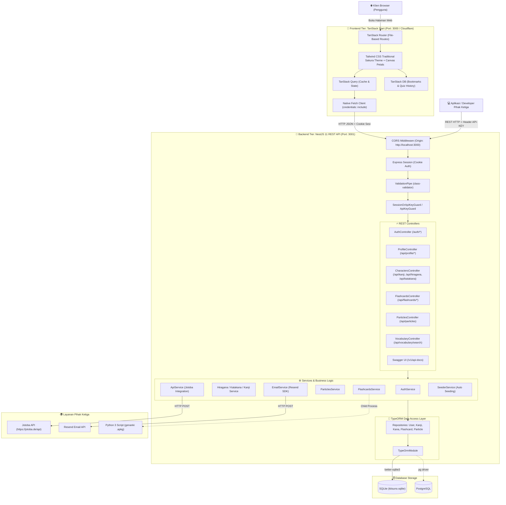
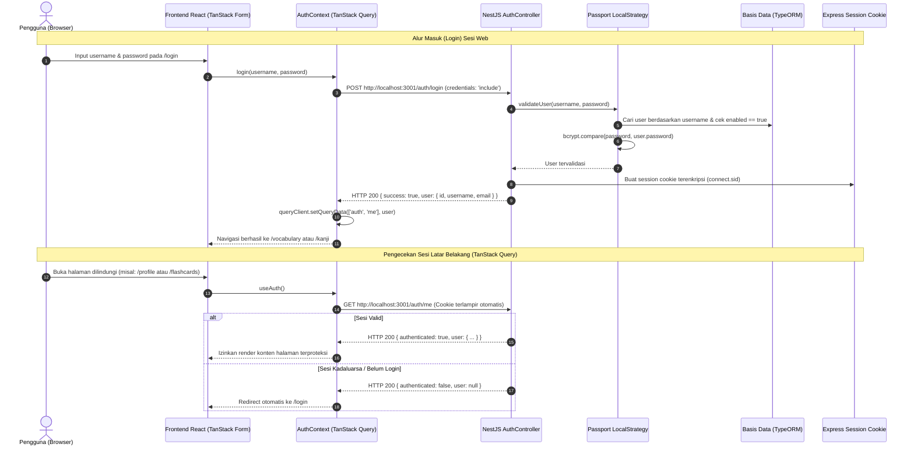
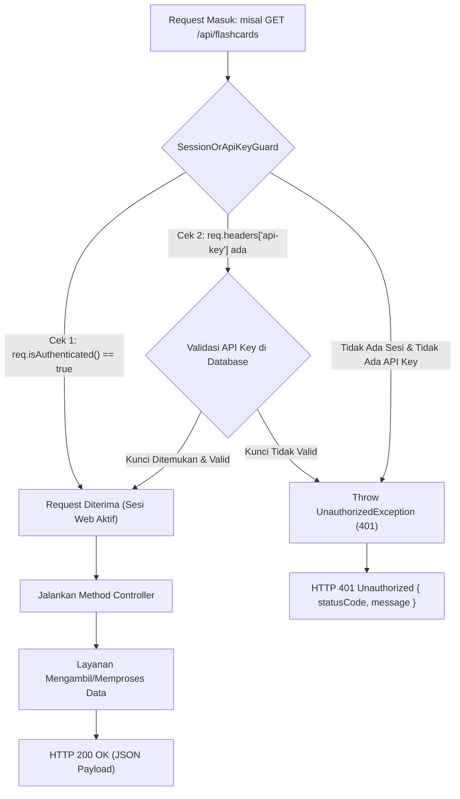
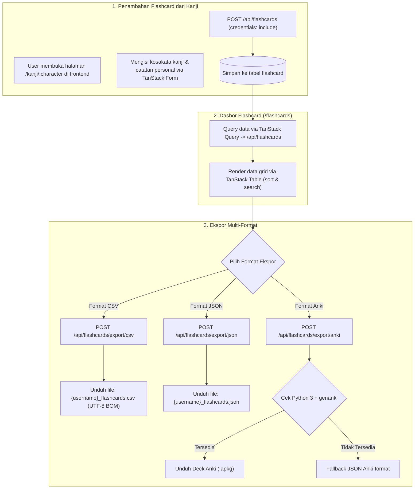
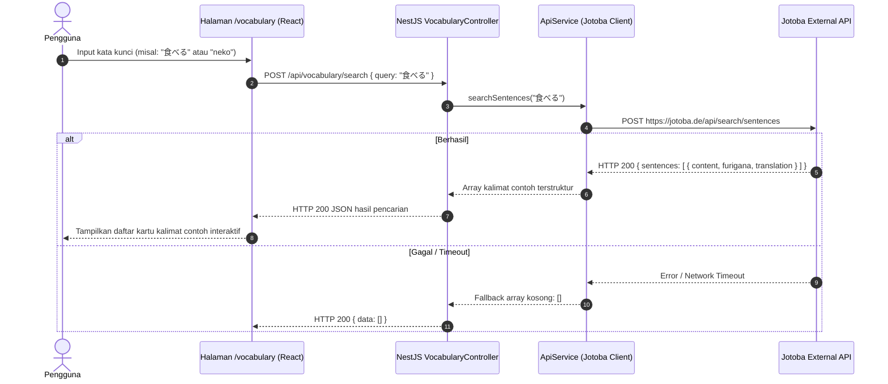

# 🌸 Kitsuno - Japanese Learning Platform (NestJS + TanStack Start Edition)

[](https://nestjs.com/)
[](https://tanstack.com/start)
[](https://tanstack.com/query)
[](https://tanstack.com/db)
[](https://tanstack.com/table)
[](https://tailwindcss.com/)
[](https://workers.cloudflare.com/)
[](https://typeorm.io/)
[](http://localhost:3001/v1/api-docs)
[](LICENSE)

**Kitsuno (狐の)** adalah platform pembelajaran bahasa Jepang modern, responsif, dan komprehensif. Arsitektur aplikasi ini telah sepenuhnya dipisahkan (*decoupled*) menjadi arsitektur modern berkecepatan tinggi:
- **Backend API**: **NestJS 11** murni REST API (Port `3001`), didukung oleh TypeORM (SQLite / PostgreSQL), autentikasi ganda (Cookie Session & API Key), Swagger OpenAPI 3.0, serta integrasi Jotoba & Resend.
- **Frontend App**: **TanStack Start (Fullstack SSR dengan React 19 & Vite 8)** (Port `3000`), didukung oleh TanStack Query, TanStack DB (reactive local collections), TanStack Table, TanStack Form, tema tradisional Sakura (Dark/Light mode) dengan animasi kanvas kelopak sakura melayang yang ringan untuk perangkat mobile, serta siap di-deploy langsung ke **Cloudflare Pages / Workers**.
- **Komunikasi Data**: Native browser `fetch` murni dengan `credentials: 'include'` (tanpa library Axios di frontend) untuk integrasi sesi autentikasi yang aman dan ringan.

Platform ini menyediakan modul pembelajaran lengkap untuk aksara **Hiragana**, **Katakana**, karakter **Kanji (Grade 1 hingga 7+)**, **Partikel Tata Bahasa (Particles)**, pencarian kalimat contoh dari **Jotoba API**, hingga sistem **Flashcard Pribadi** dengan dukungan ekspor multi-format (CSV, JSON, dan kartu Anki `.apkg` via Python `genanki`).

---

## 📑 Daftar Isi

1. [Teknologi & Tech Stack](#-teknologi--tech-stack)
2. [Struktur Direktori Monorepo](#-struktur-direktori-monorepo)
3. [Arsitektur & Flowchart Sistem](#-arsitektur--flowchart-sistem)
   - [Arsitektur Tingkat Tinggi (Decoupled Architecture)](#1-arsitektur-tingkat-tinggi-decoupled-architecture)
   - [Alur Autentikasi Pengguna (React + NestJS REST)](#2-alur-autentikasi-pengguna-react--nestjs-rest)
   - [Siklus Hidup Permintaan REST API (`SessionOrApiKeyGuard`)](#3-siklus-hidup-permintaan-rest-api-sessionorapikeyguard)
   - [Alur Manajemen Flashcard & Ekspor Multi-Format](#4-alur-manajemen-flashcard--ekspor-multi-format)
   - [Integrasi Pencarian Kosakata (Jotoba API)](#5-integrasi-pencarian-kosakata-jotoba-api)
4. [Arsitektur Frontend (TanStack Start & Traditional Sakura Theme)](#-arsitektur-frontend-tanstack-start--traditional-sakura-theme)
   - [Katalog Rute Frontend (TanStack Router)](#katalog-rute-frontend-tanstack-router)
   - [TanStack Ecosystem Integration](#tanstack-ecosystem-integration)
   - [Animasi Kelopak Sakura (Mobile-Optimized Canvas)](#animasi-kelopak-sakura-mobile-optimized-canvas)
5. [Struktur Database & Model Relasi (ERD)](#-struktur-database--model-relasi-erd)
   - [Diagram Hubungan Entitas (ERD)](#diagram-hubungan-entitas-erd)
   - [Detail Tabel Database](#detail-tabel-database)
   - [Mekanisme Otomatisasi Seeding Data](#mekanisme-otomatisasi-seeding-data)
6. [Konfigurasi & Koneksi Database (Multi-Driver)](#-konfigurasi--koneksi-database-multi-driver)
7. [Dokumentasi Lengkap API (REST Endpoints)](#-dokumentasi-lengkap-api-rest-endpoints)
   - [Spesifikasi Swagger UI](#spesifikasi-swagger-ui)
   - [Auth & Profile REST API](#auth--profile-rest-api)
   - [Characters API (Hiragana, Katakana, Kanji)](#characters-api-hiragana-katakana-kanji)
   - [Particles API](#particles-api)
   - [Vocabulary Search API](#vocabulary-search-api)
   - [Flashcards API](#flashcards-api)
8. [Panduan Menjalankan Proyek (Step-by-Step)](#-panduan-menjalankan-proyek-step-by-step)
   - [Prasyarat Sistem](#prasyarat-sistem)
   - [1. Menjalankan Backend NestJS](#1-menjalankan-backend-nestjs)
   - [2. Menjalankan Frontend TanStack Start](#2-menjalankan-frontend-tanstack-start)
   - [Akun Demo Bawaan (Default User)](#akun-demo-bawaan-default-user)
9. [Panduan Deploy ke Cloudflare (Pages / Workers)](#-panduan-deploy-ke-cloudflare-pages--workers)
10. [Troubleshooting & FAQ](#-troubleshooting--faq)

---

## 🛠 Teknologi & Tech Stack

### 1. Frontend Stack (`frontend/`)
| Kategori | Teknologi / Paket | Versi | Rationale & Fungsi |
| :--- | :--- | :--- | :--- |
| **Framework Fullstack** | [TanStack Start](https://tanstack.com/start) (`@tanstack/react-start`) | `^1.169.3` | Fullstack SSR framework modern berbasis Vite 8 dan React 19 dengan streaming SSR dan type-safe routing. |
| **Routing** | [TanStack Router](https://tanstack.com/router) (`@tanstack/react-router`) | `^1.170.45` | File-based routing 100% type-safe dengan auto-generated route tree (`routeTree.gen.ts`). |
| **State & Server Cache**| [TanStack Query](https://tanstack.com/query) (`@tanstack/react-query`) | `^5.104.5` | Manajemen caching query server, mutasi data, refetching otomatis, dan optimistic updates. |
| **Reactive Client DB** | [TanStack DB](https://tanstack.com/db) (`@tanstack/react-db`) | `^0.5.11` | Reactive local in-browser collections untuk bookmark offline dan riwayat latihan kuis. |
| **Tabel & Data Grid** | [TanStack Table](https://tanstack.com/table) (`@tanstack/react-table`) | `^8.21.3` | Headless data table untuk fitur sort, filter, dan pagination tabel karakter Kanji dan Flashcards. |
| **Form Management** | [TanStack Form](https://tanstack.com/form) (`@tanstack/react-form`) | `^1.33.5` | Type-safe form validator untuk formulir login, registrasi, kartu kanji, dan ubah password. |
| **UI Library & Core** | [React 19](https://react.dev/) & `react-dom` | `^19.3.1` | Versi stabil terbaru React dengan Action Hooks dan compiler modern. |
| **Styling & Theme** | [Tailwind CSS v4](https://tailwindcss.com/) (`@tailwindcss/vite`) | `^4.3.3` | Engine Tailwind CSS terbaru dengan CSS-first configuration dan tema tradisional Sakura Dark/Light. |
| **Ikon Visual** | [Lucide React](https://lucide.dev/) | `^1.59.0` | Ikon SVG clean dan modern untuk antarmuka pengguna. |
| **Input Romaji Kana** | [Wanakana](https://wanakana.com/) | `^5.3.1` | Library otomatisasi konversi input teks romaji ke aksara Hiragana/Katakana secara realtime. |
| **HTTP Client** | **Native Browser `fetch`** | Native | Request HTTP murni dengan `credentials: 'include'` (tanpa dependensi Axios). |
| **Cloudflare Adapter** | `@cloudflare/vite-plugin` & `wrangler` | `^1.64.0` / `^4.151.1`| Plugin Vite resmi Cloudflare untuk bundling SSR Worker dan deployment satu perintah. |

### 2. Backend Stack (Root `/`)
| Kategori | Teknologi / Paket | Versi | Rationale & Fungsi |
| :--- | :--- | :--- | :--- |
| **Framework Inti** | [NestJS](https://nestjs.com/) (`@nestjs/core`, `@nestjs/common`) | `^11.0.1` | Arsitektur modular bergaya enterprise dengan Dependency Injection dan TypeScript strict mode. |
| **Runtime & Bahasa** | [Node.js](https://nodejs.org/) & [TypeScript](https://www.typescriptlang.org/) | Node `v20+` / TS `^5.7.3` | Type-safety penuh dari entitas database, DTO, controller, hingga logic layanan. |
| **Database & ORM** | [TypeORM](https://typeorm.io/) & `@nestjs/typeorm` | `^0.3.20` / `^11.0.0` | ORM fleksibel berbasis Data Mapper yang mendukung multi-driver (SQLite & Postgres). |
| **Database Drivers** | `better-sqlite3` & `sqlite3` / `pg` | `^13.0.3` / `^8.13.1` | Driver SQLite super-cepat C++ binding (zero-config lokal) serta dukungan PostgreSQL. |
| **Autentikasi Sesi & Key**| `passport`, `passport-local`, `express-session` | `^0.7.0` / `^1.18.1` | Autentikasi ganda: Cookie Session untuk web browser dan `API-KEY` untuk integrasi REST. |
| **Kriptografi & Hashing**| `bcrypt` & `bcryptjs` | `^5.1.1` / `^3.0.3` | Pengacakan (hashing) dan verifikasi password pengguna menggunakan salted rounds aman. |
| **Validasi Payload** | `class-validator` & `class-transformer` | `^0.14.1` / `^0.5.1` | Validasi DTO otomatis pada payload request body dengan pesan kesalahan yang jelas. |
| **Dokumentasi API** | `@nestjs/swagger` & `swagger-ui-express` | `^11.0.3` / `^5.0.1` | Generator otomatis dokumentasi OpenAPI 3.0 interaktif di `http://localhost:3001/v1/api-docs`. |
| **External Email** | [Resend SDK](https://resend.com/) | `^4.1.1` | Layanan pengiriman email transaksional verifikasi akun (dengan fallback console logging). |
| **External Dictionary**| [Jotoba API](https://jotoba.de/) via `axios` | `^1.7.9` | Mesin pencarian kalimat contoh bahasa Jepang-Inggris dan referensi kosakata kontekstual. |
| **Integrasi Anki Deck**| Python 3 (`genanki`) | - | Skrip pembantu Python untuk mengekspor database flashcard menjadi file deck Anki siap pakai (`.apkg`). |

---

## 📂 Struktur Direktori Monorepo

```text
kitsuno-nest/
├── .agents/                        # Konfigurasi agen AI & skill otomasi
├── frontend/                       # 🌸 APLIKASI FRONTEND (TanStack Start + React 19)
│   ├── public/                     # Berkas statis publik (gambar, favicon, aset audio)
│   │   └── images/                 # Aset grafis (logo, favicon, navbar, flashcards)
│   ├── src/                        # Kode sumber aplikasi TanStack
│   │   ├── components/             # Komponen UI global
│   │   │   ├── Footer.tsx          # Footer bertema sakura
│   │   │   ├── Navbar.tsx          # Navigasi responsif (Desktop & Mobile) + Dark/Light toggle
│   │   │   └── SakuraPetals.tsx    # Animasi kanvas kelopak sakura melayang (ringan untuk mobile)
│   │   ├── context/                # React Context Providers
│   │   │   ├── AuthContext.tsx     # Context autentikasi login/register berbasis TanStack Query
│   │   │   └── ThemeContext.tsx    # Pengelola tema Dark / Light mode (localStorage persistent)
│   │   ├── lib/                    # Utilitas pustaka klien
│   │   │   ├── api.ts              # Klien HTTP Native Fetch dengan credentials: 'include'
│   │   │   └── db.ts               # TanStack DB Collections (bookmarksCollection & quizHistory)
│   │   ├── routes/                 # 18 Rute Halaman (TanStack Router File-Based)
│   │   │   ├── __root.tsx          # Layout root: ThemeProvider, AuthProvider, SakuraPetals
│   │   │   ├── index.tsx           # Beranda utama (Hero, Keunggulan, FAQ, Navigasi Pintas)
│   │   │   ├── about.tsx           # Halaman Tentang Kitsuno & Visi Proyek
│   │   │   ├── flashcards.tsx      # Dasbor flashcard, tabel TanStack Table, ekspor CSV/JSON/Anki
│   │   │   ├── hiragana.tsx        # Galeri interaktif 46 Hiragana + Dakuten/Yoon + Audio
│   │   │   ├── practice-hiragana.tsx # Game kuis interaktif tebak Hiragana
│   │   │   ├── katakana.tsx        # Galeri interaktif 46 Katakana + Dakuten/Yoon + Audio
│   │   │   ├── practice-katakana.tsx # Game kuis interaktif tebak Katakana
│   │   │   ├── kanji.index.tsx     # Galeri kanji dengan TanStack Table & filter grade 1-7
│   │   │   ├── kanji.$character.tsx # Detail kanji, stroke order, form tambah flashcard
│   │   │   ├── particles.tsx       # Panduan interaktif partikel bahasa Jepang (accordion)
│   │   │   ├── vocabulary.tsx      # Mesin pencarian contoh kalimat via Jotoba API
│   │   │   ├── login.tsx           # Formulir masuk akun
│   │   │   ├── register.tsx        # Formulir pendaftaran akun baru
│   │   │   ├── verify.tsx          # Halaman aktivasi akun via token email
│   │   │   ├── resend-verification.tsx # Formulir kirim ulang token aktivasi
│   │   │   ├── profile.tsx         # Profil user, ubah username/password, kelola API Key
│   │   │   ├── privacypolicy.tsx   # Dokumen kebijakan privasi
│   │   │   └── tos.tsx             # Dokumen syarat & ketentuan layanan
│   │   ├── routeTree.gen.ts        # Route tree terkompilasi otomatis oleh TanStack Router
│   │   ├── router.tsx              # Inisialisasi router instance TanStack Start
│   │   └── styles.css              # Variabel tema Sakura, gradien kartu, & utility CSS
│   ├── package.json                # Dependensi frontend & script build/deploy
│   ├── tsconfig.json               # Konfigurasi TypeScript frontend (strict & verified)
│   ├── vite.config.ts              # Konfigurasi Vite 8 + TanStack Start + Cloudflare Plugin
│   └── wrangler.jsonc              # Konfigurasi deployment Cloudflare Workers / Pages
│
├── src/                            # 🚀 APLIKASI BACKEND REST API (NestJS 11)
│   ├── entities/                   # Entitas database TypeORM
│   │   ├── flashcard.entity.ts     # Entitas kartu flashcard milik user
│   │   ├── hiragana.entity.ts      # Entitas aksara Hiragana & mnemonik
│   │   ├── kanji.entity.ts         # Entitas karakter Kanji, goresan, & cara baca
│   │   ├── katakana.entity.ts      # Entitas aksara Katakana & mnemonik
│   │   ├── particle.entity.ts      # Entitas partikel tata bahasa Jepang
│   │   └── user.entity.ts          # Entitas akun user, password hash, & API Key
│   ├── filters/                    # Filter pengecualian global
│   │   └── all-exceptions.filter.ts# Standardized JSON Error Response (RFC 7807)
│   ├── modules/                    # Modul-modul REST API
│   │   ├── auth/                   # Autentikasi: login, register, logout, verify, API Key
│   │   │   ├── guards/             # LocalAuthGuard, SessionOrApiKeyGuard, ApiKeyGuard
│   │   │   └── auth.controller.ts  # Endpoints: /auth/login, /auth/register, /auth/me, dll.
│   │   ├── characters/             # REST API: /api/hiragana, /api/katakana, /api/kanji
│   │   ├── database/               # SeederService: Otomatisasi seeding data awal
│   │   ├── email/                  # EmailService: Integrasi Resend & log console fallback
│   │   ├── flashcards/             # REST API CRUD: /api/flashcards & ekspor file
│   │   ├── particles/              # REST API: /api/particles
│   │   ├── vocabulary/             # REST API: /api/vocabulary/search (Jotoba Client)
│   │   └── web/                    # ProfileController: REST API /api/profile
│   ├── app.module.ts               # Root module NestJS (TypeORM & Config)
│   └── main.ts                     # Entry point NestJS (Port 3001, CORS, Session, Swagger)
├── public/python/                  # Skrip python untuk integrasi Anki deck
│   └── flashcards_to_anki.py       # Generator paket deck Anki .apkg
├── kitsuno.sqlite                  # Basis data SQLite bawaan (auto-seeded)
├── package.json                    # Dependensi backend NestJS
├── tsconfig.json                   # Konfigurasi TypeScript backend
└── README.md                       # Dokumentasi lengkap proyek
```

---

## 🔄 Arsitektur & Flowchart Sistem

### 1. Arsitektur Tingkat Tinggi (Decoupled Architecture)

Arsitektur aplikasi terbagi menjadi dua tier independen yang saling berkomunikasi melalui HTTP REST JSON:



---

### 2. Alur Autentikasi Pengguna (React + NestJS REST)

Diagram berikut menjelaskan siklus login dan sinkronisasi sesi cookie antara TanStack Query di frontend dan Passport Express Session di backend:



---

### 3. Siklus Hidup Permintaan REST API (`SessionOrApiKeyGuard`)

Semua rute data dilindungi oleh guard pintar yang menerima otentikasi sesi cookie web browser ATAU header `API-KEY`:



---

### 4. Alur Manajemen Flashcard & Ekspor Multi-Format



---

### 5. Integrasi Pencarian Kosakata (Jotoba API)

Frontend mengirim kata kunci pencarian ke NestJS, yang bertindak sebagai gateway aman menuju Jotoba API:



---

## 🎨 Arsitektur Frontend (TanStack Start & Traditional Sakura Theme)

### Katalog Rute Frontend (TanStack Router)

Semua rute diimplementasikan secara deklaratif dan type-safe di dalam direktori `frontend/src/routes/`:

| Rute URL | Berkas Komponen | Fungsi & Integrasi Teknologi |
| :--- | :--- | :--- |
| `/` | `index.tsx` | Landing page interaktif, ringkasan koleksi lokal TanStack DB, statistik, dan FAQ accordion. |
| `/vocabulary` | `vocabulary.tsx` | Mesin pencarian contoh kalimat bahasa Jepang dan terjemahan via Jotoba API. |
| `/hiragana` | `hiragana.tsx` | Tabel interaktif 46 Hiragana + Dakuten + Yoon, pemutar audio asli, diagram stroke order, dan bookmark lokal TanStack DB. |
| `/practice-hiragana` | `practice-hiragana.tsx` | Game latihan interaktif tebak romaji dengan penilaian realtime, pelacak streak, dan riwayat skor kuis di TanStack DB. |
| `/katakana` | `katakana.tsx` | Tabel interaktif 46 Katakana + Dakuten + Yoon, pemutar audio, stroke order, dan bookmark lokal. |
| `/practice-katakana` | `practice-katakana.tsx` | Game latihan interaktif tebak romaji Katakana dengan penilaian instan. |
| `/kanji` | `kanji.index.tsx` | Galeri kanji lengkap dengan **TanStack Table** (multi-column sort, search filter, switch tampilan tabel vs kartu grid). |
| `/kanji/$character` | `kanji.$character.tsx` | Lembar detail kanji mendalam (SVG goresan kuas, Kun'yomi, On'yomi, makna) dan formulir TanStack Form untuk menambah flashcard. |
| `/flashcards` | `flashcards.tsx` | Dasbor koleksi flashcard personal dengan data table TanStack Table, tombol unduh CSV, JSON, dan Anki `.apkg`. |
| `/particles` | `particles.tsx` | Katalog 15 partikel tata bahasa Jepang dengan accordion interaktif, rumus pembentukan kalimat, dan contoh praktis. |
| `/profile` | `profile.tsx` | Dasbor akun: form ganti username, ganti password, statistik bookmark TanStack DB, dan manajemen regenerasi API Key. |
| `/login` | `login.tsx` | Formulir login akun berbasis TanStack Form dan autentikasi sesi cookie. |
| `/register` | `register.tsx` | Formulir pendaftaran akun baru dengan validasi konfirmasi password realtime. |
| `/verify` | `verify.tsx` | Validasi token aktivasi akun via query parameter URL. |
| `/resend-verification`| `resend-verification.tsx` | Formulir permintaan pengiriman ulang email token aktivasi. |
| `/about` | `about.tsx` | Informasi visi proyek Kitsuno dan perincian arsitektur teknologi. |
| `/privacypolicy` | `privacypolicy.tsx` | Lembar kebijakan privasi pengguna. |
| `/tos` | `tos.tsx` | Lembar syarat dan ketentuan penggunaan layanan. |

---

### TanStack Ecosystem Integration

1. **TanStack Start & Router**: Seluruh navigasi ditangani secara client-side hydration dengan zero reload, lazy-loaded route chunks, dan status router tergenerasi otomatis di [frontend/src/routeTree.gen.ts](file:///c:/Users/minipingu/Desktop/kitsuno-nest/frontend/src/routeTree.gen.ts).
2. **TanStack Query**: Mengelola cache data server (`['kanji']`, `['hiragana']`, `['flashcards']`, `['auth', 'me']`) dengan penanganan loading skeleton yang halus dan otomatis invalidate cache saat ada mutasi data.
3. **TanStack DB**: Mengelola koleksi data reaktif sisi klien (`bookmarksCollection` dan `quizHistoryCollection`) di [frontend/src/lib/db.ts](file:///c:/Users/minipingu/Desktop/kitsuno-nest/frontend/src/lib/db.ts). Pengguna dapat mem-bookmark karakter dan menyimpan riwayat kuis secara instan tanpa harus login.
4. **TanStack Table**: Menggerakkan tabel data kanji dan flashcard dengan fitur sorting dinamis, pencarian realtime per kata, dan kontrol paginasi halaman yang cepat.
5. **TanStack Form**: Mengelola validasi form pada sisi klien dengan feedback error instan sebelum data dikirim ke endpoint backend.

---

### Animasi Kelopak Sakura (Mobile-Optimized Canvas)

Komponen [SakuraPetals.tsx](file:///c:/Users/minipingu/Desktop/kitsuno-nest/frontend/src/components/SakuraPetals.tsx) dipasang secara global pada [__root.tsx](file:///c:/Users/minipingu/Desktop/kitsuno-nest/frontend/src/routes/__root.tsx):
- **High-Performance Canvas 2D**: Menggunakan elemen HTML5 Canvas murni yang ringan dengan `requestAnimationFrame`.
- **Adaptive Petal Count**: Menyesuaikan jumlah kelopak secara dinamis berdasarkan ukuran layar (15 kelopak untuk layar ponsel/mobile dan 35 kelopak untuk layar desktop) untuk menjaga stabilitas 60 FPS pada semua perangkat.
- **Physics Realistis**: Setiap kelopak memiliki variasi kecepatan jatuh, ayunan horizontal (sinusoidal wind drift), rotasi 3D (3D flip effect), dan penyesuaian opasitas otomatis saat berganti antara Dark Mode dan Light Mode.
- **Accessibility Friendly**: Secara otomatis mendeteksi dan menghormati preferensi pengguna `prefers-reduced-motion`.

---

## 🗄 Struktur Database & Model Relasi (ERD)

### Diagram Hubungan Entitas (ERD)

```mermaid
erDiagram
    USERS ||--o{ FLASHCARD : "memiliki banyak (1:N)"
    KANJI ||--o{ FLASHCARD : "direferensikan oleh (1:N)"

    USERS {
        int id PK "Auto Increment"
        varchar username "Unique, max 14 char"
        varchar email "Unique"
        varchar password "Bcrypt hash"
        varchar join_date "Tanggal bergabung (YYYY-MM-DD)"
        varchar api_key "Unique, UUID v4 token"
        boolean enabled "Status aktivasi verifikasi email"
        varchar verification_token "Token unik 64 char verifikasi"
    }

    KANJI {
        int id PK "Auto Increment"
        varchar character "Karakter Kanji tunggal (e.g. 日)"
        int stroke_count "Jumlah goresan kuas"
        int grade "Tingkat kelas sekolah (1 - 7)"
        text meanings "Arti/terjemahan bahasa Inggris"
        text onyomi_readings "Simple-array (e.g. ニチ, ジツ)"
        text kunyomi_readings "Simple-array (e.g. ひ, -び)"
        text stroke_order_svg "Markup SVG diagram urutan goresan"
        text vocab "Simple-array contoh kosakata & bacaan"
    }

    FLASHCARD {
        int id PK "Auto Increment"
        int user_id FK "Relasi ke tabel USERS (CASCADE ON DELETE)"
        int kanji_id FK "Relasi ke tabel KANJI (CASCADE ON DELETE)"
        text vocabulary "Simple-array kata & arti yang dicatat user"
        text notes "Catatan personal hafalan (max 200)"
    }

    HIRAGANA {
        int id PK "Auto Increment"
        varchar character "Aksara Hiragana (e.g. あ)"
        varchar romaji "Romanisasi alfabet (e.g. a)"
        varchar audio "Tautan URL audio pelafalan mp3"
        varchar mnemonic "Deskripsi singkat asosiasi visual"
        varchar story "Cerita visual pembantu ingatan"
        varchar stroke_order "Nama berkas SVG urutan goresan"
    }

    KATAKANA {
        int id PK "Auto Increment"
        varchar character "Aksara Katakana (e.g. ア)"
        varchar romaji "Romanisasi alfabet (e.g. a)"
        varchar audio "Tautan URL audio pelafalan mp3"
        varchar mnemonic "Deskripsi singkat asosiasi visual"
        varchar story "Cerita visual pembantu ingatan"
        varchar stroke_order "Nama berkas SVG urutan goresan"
    }

    PARTICLE {
        int id PK "Auto Increment"
        varchar particle "Nama partikel (e.g. は (wa))"
        varchar meaning "Fungsi utama partikel"
        text description "Penjelasan mendalam aturan penggunaan"
        text formation "Pola rumus susunan tata bahasa"
        text example "Contoh kalimat Jepang & terjemahan"
    }
```



---

### Detail Tabel Database

1. **`users`**: Menyimpan kredensial pengguna, password hash Bcrypt, status aktivasi email, dan token rahasia `api_key`.
2. **`kanji`**: Koleksi karakter Kanji lengkap beserta goresan kuas SVG, grade klasifikasi, bacaan On'yomi, Kun'yomi, dan daftar kosakata standar.
3. **`flashcard`**: Koleksi kartu pengingat kanji pribadi milik pengguna, berelasi *Many-to-One* ke `users` dan `kanji` (dengan penghapusan kaskade).
4. **`hiragana` & `katakana`**: 46 aksara suku kata Jepang dasar beserta tautan audio penutur asli dan cerita mnemonik visual.
5. **`particle`**: 15 partikel gramatikal bahasa Jepang (wa, ga, o, ni, de, e, to, mo, kara, made, yori, ne, yo, ka, no).

---

### Mekanisme Otomatisasi Seeding Data

Saat backend NestJS dinyalakan pertama kali, `[SeederService](file:///c:/Users/minipingu/Desktop/kitsuno-nest/src/modules/database/seeder.service.ts)` secara otomatis memeriksa apakah database sudah memiliki data awal:
- Jika kosong, sistem otomatis menyemai 46 aksara Hiragana, 46 aksara Katakana, puluhan karakter Kanji Grade 1-7 lengkap dengan SVG goresan, dan 15 partikel tata bahasa.
- Menyemai **User Demo** bawaan (`username: demo`, `password: password123`) yang sudah langsung aktif (`enabled: true`) beserta kartu flashcard contoh.

---

## 🔌 Konfigurasi & Koneksi Database (Multi-Driver)

Kitsuno mendukung pergantian driver database secara instan cukup dengan mengatur variabel di file `.env`:

### 1. Mode SQLite (Lokal / Zero-Config)
```ini
DATABASE_TYPE=sqlite
DB_TYPE=sqlite
DATABASE_FILE=kitsuno.sqlite
```

### 2. Mode PostgreSQL (Produksi / Cloud)
```ini
DATABASE_TYPE=postgres
DB_TYPE=postgres
DB_HOST=localhost
DB_PORT=5432
DB_USERNAME=postgres
DB_PASSWORD=postgres
DB_NAME=kitsuno
```

---

## 📡 Dokumentasi Lengkap API (REST Endpoints)

### Spesifikasi Swagger UI
- **URL Dokumentasi OpenAPI**: [http://localhost:3001/v1/api-docs](http://localhost:3001/v1/api-docs)
- **Header Autentikasi**:
  ```http
  API-KEY: <your-api-key>
  ```
  *(Atau menggunakan cookie sesi browser `credentials: 'include'` jika diakses dari aplikasi web)*

---

### Auth & Profile REST API

| Method | Endpoint | Deskripsi & Payload |
| :--- | :--- | :--- |
| `POST` | `/auth/login` | Masuk akun (`{ username, password }`). Mengembalikan user data & menetapkan cookie sesi. |
| `POST` | `/auth/register` | Mendaftar akun baru (`{ username, email, password, confirmPassword }`). |
| `POST` | `/auth/logout` | Menghapus sesi autentikasi pengguna. |
| `GET` | `/auth/me` | Memeriksa status sesi login pengguna saat ini. |
| `GET` | `/auth/verify?token=...` | Memvalidasi token aktivasi email. |
| `POST` | `/auth/resend-verification` | Meminta pengiriman ulang token aktivasi email (`{ email }`). |
| `GET` | `/api/profile` | Mengambil detail profil akun & statistik flashcard. |
| `POST` | `/api/profile/username` | Mengubah username akun pengguna (`{ username }`). |
| `POST` | `/api/profile/password` | Mengubah password pengguna (`{ currentPassword, newPassword, confirmPassword }`). |
| `POST` | `/api/profile/api-key` | Meregenerasi token `API-KEY` baru untuk akun pengguna. |

---

### Characters API (Hiragana, Katakana, Kanji)

| Method | Endpoint | Deskripsi |
| :--- | :--- | :--- |
| `GET` | `/api/hiragana` | Mengambil seluruh 46 aksara Hiragana beserta audio & mnemonik. |
| `GET` | `/api/hiragana/:romaji` | Mengambil 1 aksara Hiragana berdasarkan kunci romaji (misal: `/api/hiragana/ka`). |
| `GET` | `/api/katakana` | Mengambil seluruh 46 aksara Katakana beserta audio & mnemonik. |
| `GET` | `/api/katakana/:romaji` | Mengambil 1 aksara Katakana berdasarkan kunci romaji (misal: `/api/katakana/shi`). |
| `GET` | `/api/kanji` | Mengambil seluruh daftar karakter Kanji (dapat difilter dengan query `?grade=1`). |
| `GET` | `/api/kanji/:id` | Mengambil detail karakter Kanji berdasarkan ID numerik. |
| `GET` | `/api/kanji/character/:char` | Mengambil detail karakter Kanji berdasarkan karakter fisik (misal: `/api/kanji/character/日`). |

---

### Particles API

| Method | Endpoint | Deskripsi |
| :--- | :--- | :--- |
| `GET` | `/api/particles` | Mengambil seluruh koleksi 15 partikel tata bahasa Jepang beserta rumus & contoh kalimat. |

---

### Vocabulary Search API

| Method | Endpoint | Deskripsi |
| :--- | :--- | :--- |
| `POST` | `/api/vocabulary/search` | Mencari contoh kalimat bahasa Jepang dan arti kata via Jotoba API (`{ "query": "食べる" }`). |

---

### Flashcards API

| Method | Endpoint | Deskripsi |
| :--- | :--- | :--- |
| `GET` | `/api/flashcards` | Mengambil seluruh flashcard milik pengguna yang sedang terautentikasi. |
| `GET` | `/api/flashcards/:id` | Mengambil 1 kartu flashcard berdasarkan ID. |
| `POST` | `/api/flashcards` | Membuat kartu flashcard baru (`{ kanjiId, vocabWord1, vocabMeaning1, notes }`). |
| `PUT` | `/api/flashcards/:id` | Memperbarui kartu flashcard yang ada. |
| `DELETE`| `/api/flashcards/:id` | Menghapus kartu flashcard milik pengguna. |
| `POST` | `/api/flashcards/export/csv` | Mengunduh koleksi flashcard dalam format file `.csv` (UTF-8 BOM). |
| `POST` | `/api/flashcards/export/json`| Mengunduh koleksi flashcard dalam format file `.json`. |
| `POST` | `/api/flashcards/export/anki`| Mengunduh koleksi flashcard dalam format deck Anki (`.apkg`). |

---

## 🚀 Panduan Menjalankan Proyek (Step-by-Step)

### Prasyarat Sistem
- **Node.js**: Versi `20.x` atau `24.x` LTS.
- **Package Manager**: `npm` atau `pnpm`.
- **Python 3 & genanki** *(Opsional)*: Diperlukan jika ingin mengekspor file deck Anki `.apkg` (`pip install genanki`).

---

### 1. Menjalankan Backend NestJS

Buka terminal di root direktori proyek (`kitsuno-nest/`):

```bash
# 1. Salin template environment jika belum ada
cp .env.example .env

# 2. Install dependensi backend
npm install
# (atau jika menggunakan pnpm: pnpm install && pnpm approve-builds --all)

# 3. Jalankan server backend dalam mode pengembangan
npm run start:dev
```

Server backend NestJS akan aktif di:
- **REST API & Server**: `http://localhost:3001`
- **Swagger Documentation**: `http://localhost:3001/v1/api-docs`

---

### 2. Menjalankan Frontend TanStack Start

Buka jendela terminal baru dan arahkan ke folder `frontend/`:

```bash
cd frontend

# 1. Install dependensi frontend (jika belum terinstal)
npm install
# (atau: pnpm install)

# 2. Periksa tipe TypeScript (verifikasi 0 error)
npm run check

# 3. Jalankan server frontend dalam mode pengembangan
npm run dev
```

Aplikasi web TanStack Start akan aktif di:
- **Aplikasi Web**: [http://localhost:3000](http://localhost:3000)

---

### Akun Demo Bawaan (Default User)

Untuk langsung menguji seluruh fitur terproteksi tanpa registrasi manual:
| Parameter | Kredensial Demo |
| :--- | :--- |
| **Username** | `demo` |
| **Password** | `password123` |
| **Email** | `demo@kitsuno.app` |
| **Status Akun** | Terverifikasi (`enabled: true`) |
| **Personal API Key** | `demo-api-key-1234567890abcdef` |

---

## ☁️ Panduan Deploy ke Cloudflare (Pages / Workers)

Frontend Kitsuno telah dikonfigurasi dengan `@cloudflare/vite-plugin` dan file [wrangler.jsonc](file:///c:/Users/minipingu/Desktop/kitsuno-nest/frontend/wrangler.jsonc) sehingga siap di-deploy ke Cloudflare:

### Opsi A: Deploy Langsung via CLI (Wrangler)
```powershell
cd frontend

# 1. Login ke akun Cloudflare Anda
npx wrangler login

# 2. Build dan deploy otomatis ke Cloudflare
npm run deploy
```

### Opsi B: Deploy via Cloudflare Dashboard (Git Repository)
1. Hubungkan repository GitHub Anda ke Cloudflare Pages.
2. Atur konfigurasi build berikut:
   - **Root directory**: `frontend`
   - **Framework preset**: `None` / `Vite`
   - **Build command**: `npm run build`
   - **Build output directory**: `dist/client`
3. Tambahkan Environment Variable:
   - `VITE_API_URL`: URL public backend NestJS Anda (misal: `https://api.domain-anda.com`).

---

## ❓ Troubleshooting & FAQ

#### 1. Port 3000 atau 3001 sudah terpakai
- Jika port backend 3001 bentrok, sesuaikan nilai `PORT=3002` pada file `.env` root.
- Jika port frontend 3000 bentrok, ubah opsi port di `frontend/vite.config.ts`.

#### 2. Pesan Peringatan Git Line Endings (`LF will be replaced by CRLF`)
Proyek telah dikonfigurasi dengan normalisasi baris Windows `CRLF` dan pengaturan `git config core.safecrlf false` sehingga pesan peringatan konversi baris tidak akan mengganggu alur pengembangan di Windows.

#### 3. Error verifikasi TypeScript di frontend
Frontend dilengkapi script pemeriksaan tipe ketat:
```bash
cd frontend
npm run check
```
Script tersebut menjalankan `tsc --noEmit` dan telah diverifikasi menghasilkan **0 errors**.

#### 4. Ekspor kartu Anki `.apkg` menghasilkan file JSON
Pembuatan file `.apkg` asli memerlukan Python 3 dengan modul `genanki`:
```bash
pip install genanki
```
Jika Python belum terpasang, sistem secara otomatis memberikan fallback data JSON terstruktur yang aman untuk diimpor ke Anki.

---

<div align="center">
  <sub>Dibangun dengan ❤️ oleh Tim Kitsuno. Hak Cipta &copy; 2026. Lisensi MIT.</sub>
</div>
