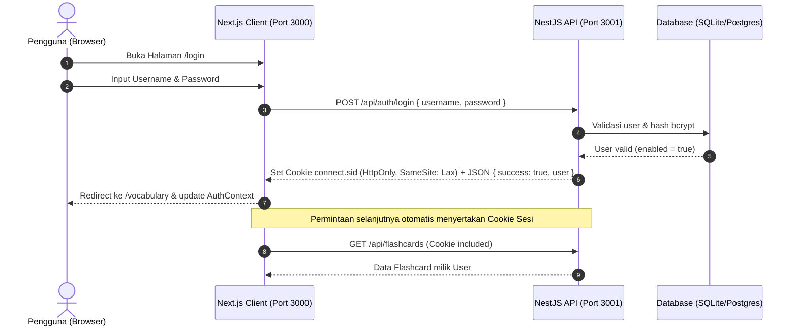
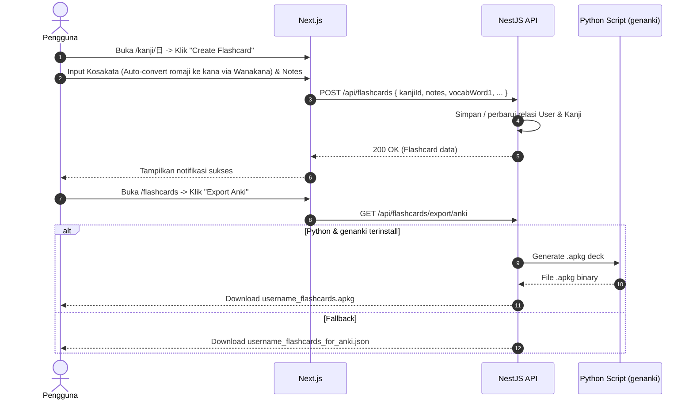
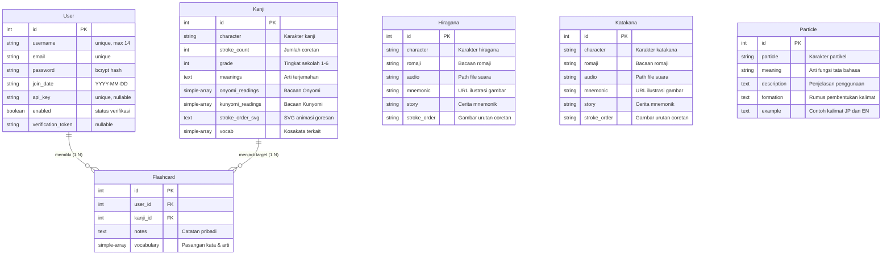

# 🌸 Kitsuno - Japanese Learning Platform

> Platform pembelajaran bahasa Jepang modern, interaktif, dan berestetika tradisional Sakura yang dibangun dengan arsitektur decoupled: **NestJS REST API** di backend dan **TanStack Start (React 19)** di frontend (TanStack Query, TanStack DB, TanStack Table & TanStack Form).

---

## 📑 Daftar Isi
1. [Ringkasan Arsitektur](#-ringkasan-arsitektur)
2. [Flowchart & Alur Kerja](#-flowchart--alur-kerja)
3. [Struktur Folder & Aplikasi](#-struktur-folder--aplikasi)
4. [Backend (NestJS API)](#-backend-nestjs-api)
5. [Frontend (TanStack Start & React 19)](#-frontend-tanstack-start--react-19)
6. [Struktur & Relasi Database](#-struktur--relasi-database)
7. [Dokumentasi Lengkap REST API](#-dokumentasi-lengkap-rest-api)
8. [Konfigurasi & Koneksi Database](#-konfigurasi--koneksi-database)
9. [Panduan Menjalankan Project](#-panduan-menjalankan-project)

---

## 🏛 Ringkasan Arsitektur

Aplikasi Kitsuno mengadopsi pola **Decoupled Client-Server**:
- **Backend**: NestJS yang beroperasi murni sebagai RESTful API tanpa template engine (Handlebars telah sepenuhnya dimigrasi).
- **Frontend**: TanStack Start (React 19 / Vite 8 SSR) dengan:
  - **TanStack Query (`@tanstack/react-query`)**: Manajemen caching, server-state, dan mutasi data.
  - **TanStack DB (`@tanstack/react-db`)**: Koleksi reaktif client-side lokal untuk bookmarking karakter dan riwayat kuis offline.
  - **TanStack Table (`@tanstack/react-table`)**: Data-grid interaktif dengan sorting, global search filter, dan pagination.
  - **TanStack Form (`@tanstack/react-form`)**: Manajemen state form type-safe untuk flashcard dan akun.
  - **Sakura Theme**: Tema visual tradisional Jepang Sakura dengan dukungan **Dark Mode (Yozakura)** & **Light Mode (Asa-Sakura)**.
  - **Native Fetch Client**: Tanpa axios, menggunakan standard browser `fetch` dengan `credentials: 'include'`.
- **Autentikasi Ganda (Dual-Auth)**:
  - *Browser Web (TanStack)*: Berbasis **Express Session + Passport Cookie** (`credentials: 'include'`).
  - *External REST API Client*: Berbasis header **`API-KEY`**.

```mermaid
graph LR
    subgraph Frontend ["Frontend: Next.js (Port 3000)"]
        UI_Home["Landing (/)"]
        UI_Kana["Hiragana & Katakana (/hiragana, /katakana)"]
        UI_Quiz["Practice Quiz (/practice-hiragana, /practice-katakana)"]
        UI_Kanji["Kanji & Details (/kanji, /kanji/:character)"]
        UI_Flashcards["3D Flip Flashcards (/flashcards)"]
        UI_Vocab["Vocabulary Search (/vocabulary)"]
        UI_Particles["Grammar Particles (/particles)"]
        UI_Auth["Auth & Profile (/login, /register, /profile)"]
    end

    subgraph Backend ["Backend: NestJS REST API (Port 3001)"]
        API_Auth["/api/auth"]
        API_Char["/api/characters"]
        API_Part["/api/particles"]
        API_Flash["/api/flashcards"]
        API_Vocab["/api/vocabulary"]
        API_Prof["/api/profile"]
        Swagger["/v1/api-docs"]
    end

    subgraph Storage ["Database Layer"]
        TypeORM["TypeORM (Active Record / Data Mapper)"]
        SQLite[("SQLite: kitsuno.sqlite")]
        Postgres[("PostgreSQL (Optional)")]
    end

    subgraph External ["External Services"]
        Jotoba["Jotoba Japanese Dictionary API"]
        Resend["Resend Email Service"]
    end

    Frontend -->|HTTP / CORS with Credentials| Backend
    Backend --> TypeORM
    TypeORM --> SQLite
    TypeORM -.-> Postgres
    Backend --> Jotoba
    Backend --> Resend
```



---

## 📊 Flowchart & Alur Kerja

### 1. Alur Autentikasi & Sesi (Session & API Key)



### 2. Alur Pembuatan & Ekspor Flashcard



---

## 📂 Struktur Folder & Aplikasi

```
kitsuno-nest/
├── frontend/                          # 🚀 TANSTACK START FRONTEND (React 19)
│   ├── public/                        # Aset statis client
│   │   ├── images/
│   │   │   ├── navbar/                # Ikon navigasi
│   │   │   ├── favicon/               # Favicon
│   │   │   ├── kanji/                 # Panah dan visual kanji
│   │   │   └── welcome/               # Ilustrasi landing page
│   ├── src/
│   │   ├── routes/                    # File-based routing (TanStack Router)
│   │   │   ├── __root.tsx             # Root Layout (QueryClient, ThemeProvider, Navbar, Footer)
│   │   │   ├── index.tsx              # Landing / Welcome Page
│   │   │   ├── hiragana.tsx           # Tabel Hiragana + Audio + Modal Mnemonic + Bookmark
│   │   │   ├── practice-hiragana.tsx  # Game Kuis Romaji Hiragana + TanStack DB History
│   │   │   ├── katakana.tsx           # Tabel Katakana + Audio + Modal Mnemonic
│   │   │   ├── practice-katakana.tsx  # Game Kuis Romaji Katakana + TanStack DB History
│   │   │   ├── kanji.index.tsx        # Katalog Kanji (TanStack Table + Grid Mode)
│   │   │   ├── kanji.$character.tsx   # Detail Kanji + TanStack Form Flashcard
│   │   │   ├── flashcards.tsx         # 3D Flip Flashcards + TanStack Table + Ekspor
│   │   │   ├── particles.tsx          # Accordion Partikel JLPT N5 + Pembentukan
│   │   │   ├── vocabulary.tsx         # Pencarian Kosakata & Contoh Kalimat Jotoba
│   │   │   ├── login.tsx              # Login Form (TanStack Form)
│   │   │   ├── register.tsx           # Registrasi Akun (TanStack Form)
│   │   │   ├── verify.tsx             # Verifikasi Email Token
│   │   │   ├── resend-verification.tsx# Kirim Ulang Link Verifikasi
│   │   │   ├── profile.tsx            # Manajemen Akun & Developer API Key
│   │   │   ├── about.tsx              # Tentang Aplikasi
│   │   │   ├── privacypolicy.tsx      # Kebijakan Privasi
│   │   │   └── tos.tsx                # Syarat dan Ketentuan
│   │   ├── components/                # Komponen UI Reusable
│   │   │   ├── Navbar.tsx             # Sakura Navigasi atas & mobile bottom nav
│   │   │   └── Footer.tsx             # Sakura Footer navigasi
│   │   ├── context/
│   │   │   ├── AuthContext.tsx        # TanStack Query Auth & Manajemen Sesi
│   │   │   └── ThemeContext.tsx       # Dark Mode / Light Mode Sakura Theme
│   │   ├── lib/
│   │   │   ├── api.ts                 # Native Fetch Client (credentials: 'include')
│   │   │   └── db.ts                  # TanStack DB Collections (Bookmarks & Quiz History)
│   │   ├── router.tsx                 # TanStack Router Instance Factory
│   │   ├── routeTree.gen.ts           # Auto-generated Route Tree
│   │   └── styles.css                 # Tailwind CSS 4 & Tema Tradisional Sakura
│   ├── package.json
│   ├── vite.config.ts                 # Vite 8 + TanStack Start + Tailwind Plugin
│   └── tsconfig.json
│
├── src/                               # ⚙️ NESTJS BACKEND API
│   ├── entities/                      # TypeORM Database Entities
│   │   ├── user.entity.ts             # Entitas Pengguna & Autentikasi
│   │   ├── hiragana.entity.ts         # Karakter Hiragana & Mnemonic
│   │   ├── katakana.entity.ts         # Karakter Katakana & Mnemonic
│   │   ├── kanji.entity.ts            # Kanji, Radikal, Readings, SVG
│   │   ├── particle.entity.ts         # Partikel JLPT N5 & Contoh
│   │   ├── flashcard.entity.ts        # Kartu Belajar Pengguna
│   │   └── index.ts
│   ├── modules/
│   │   ├── auth/                      # Autentikasi, Passport, Strategy, Guards
│   │   │   ├── auth.controller.ts     # /api/auth (login, register, me, verify)
│   │   │   ├── auth.service.ts
│   │   │   ├── guards/                # AuthenticatedGuard & ApiKeyGuard
│   │   │   └── strategies/            # Passport LocalStrategy
│   │   ├── characters/                # /api/characters, /api/hiragana, /api/kanji
│   │   │   ├── characters.controller.ts
│   │   │   ├── hiragana.service.ts
│   │   │   ├── katakana.service.ts
│   │   │   ├── kanji.service.ts
│   │   │   └── utils/kana.utils.ts
│   │   ├── flashcards/                # /api/flashcards (CRUD & Exports)
│   │   │   ├── flashcards.controller.ts
│   │   │   └── flashcards.service.ts
│   │   ├── particles/                 # /api/particles
│   │   │   ├── particles.controller.ts
│   │   │   └── particles.service.ts
│   │   ├── vocabulary/                # /api/vocabulary (Jotoba API)
│   │   │   ├── vocabulary.controller.ts
│   │   │   └── api.service.ts
│   │   ├── web/                       # /api/profile
│   │   │   └── profile.controller.ts
│   │   ├── email/                     # Pengiriman Email Verifikasi (Resend)
│   │   └── database/                  # Database Seeder Otomatis
│   │       └── seeder.service.ts
│   ├── filters/                       # AllExceptionsFilter (JSON responses)
│   ├── app.module.ts                  # Root Module
│   └── main.ts                        # Entry Point (CORS, Session, Swagger)
│
├── kitsuno.sqlite                     # File Database SQLite Default
├── .env                               # Konfigurasi Environment
├── package.json                       # Backend Dependencies
└── tsconfig.json
```

---

## 🛠 Backend (NestJS API)

Backend NestJS berjalan sebagai REST API yang stateless dan murni JSON:
1. **CORS Terintegrasi**: Mengizinkan akses origin `http://localhost:3000` dengan `credentials: true`.
2. **Dual-Guard Security**: `AuthenticatedGuard` memvalidasi sesi cookie dari browser, sekaligus mendukung API Key melalui header `X-API-KEY`.
3. **Automatic Database Seeding**: Saat server pertama kali menyala, `SeederService` otomatis mengecek dan memuat 46 Hiragana, 46 Katakana, seluruh karakter Joyo Kanji, dan partikel bahasa Jepang ke database jika tabel masih kosong.
4. **OpenAPI / Swagger**: Dokumentasi interaktif REST API tersedia secara langsung di endpoint `/v1/api-docs`.

---

## 💻 Frontend (TanStack Start & React 19)

Frontend dibangun dengan ekosistem TanStack modern:
1. **TanStack Start & Router**: File-based fullstack routing dengan Server-Side Rendering (SSR) dan dynamic code-splitting secepat kilat menggunakan Vite 8.
2. **TanStack Query (`@tanstack/react-query`)**: Manajemen caching server state, prefetching, retry otomatis, dan sinkronisasi realtime untuk data Kana, Kanji, Partikel, Kosakata, dan Flashcards.
3. **TanStack DB (`@tanstack/react-db`)**: Penyimpanan client-side reaktif lokal (in-memory & localStorage-backed) untuk bookmarking karakter instan dan riwayat skor sesi kuis tanpa latensi network.
4. **TanStack Table (`@tanstack/react-table`)**: Data-grid headless untuk katalog Kanji dan Flashcards dengan sorting kolom (Grade, 画数), live global search filtering, dan pagination.
5. **TanStack Form (`@tanstack/react-form`)**: Manajemen state form type-safe untuk login, register, ganti password, dan perakitan kartu flashcard.
6. **Traditional Japanese Sakura Theme**: Desain estetik bernuansa bunga sakura dengan transisi halus antara **Dark Mode (Yozakura - 夜桜)** dan **Light Mode (Asa-Sakura - 朝桜)**.
7. **Wanakana IME**: Otomatis mengonversi ketikan romaji menjadi karakter Hiragana secara real-time saat pengguna mengetik kosakata flashcard.
8. **Native Fetch Client**: Tanpa axios — pure browser fetch dengan `credentials: 'include'` untuk otentikasi session cookie yang aman.
9. **Interactive 3D Flip Flashcards & Ekspor**: Kartu kanji 3D flip dengan ekspor instan ke format CSV, JSON, atau deck Anki (`.apkg`).

---

## 🗄 Struktur & Relasi Database

### Entity-Relationship Diagram (ERD)



---

## 📡 Dokumentasi Lengkap REST API

Swagger UI interaktif dapat diakses pada: **`http://localhost:3001/v1/api-docs`**.

### 1. Autentikasi (`/api/auth`)
| Method | Endpoint | Deskripsi | Auth |
| :--- | :--- | :--- | :--- |
| `GET` | `/api/auth/me` | Cek status sesi & user yang sedang login | Bebas |
| `POST` | `/api/auth/login` | Login user (body: `{ username, password }`) | Bebas |
| `POST` | `/api/auth/register` | Mendaftar akun baru | Bebas |
| `POST` | `/api/auth/logout` | Logout dan menghapus session cookie | Sesi |
| `GET` | `/api/auth/verify?token=...` | Verifikasi akun dengan token email | Bebas |
| `POST` | `/api/auth/resend-verification` | Kirim ulang email verifikasi | Bebas |

### 2. Karakter Kana & Kanji (`/api`)
| Method | Endpoint | Deskripsi | Auth |
| :--- | :--- | :--- | :--- |
| `GET` | `/api/hiragana` | Ambil seluruh 46 karakter Hiragana | Publik |
| `GET` | `/api/hiragana/grouped` | Ambil Hiragana berformat grid + varian Dakuon & Yoon | Publik |
| `GET` | `/api/hiragana/:romaji` | Ambil detail karakter Hiragana berdasarkan romaji | Publik |
| `GET` | `/api/katakana` | Ambil seluruh 46 karakter Katakana | Publik |
| `GET` | `/api/katakana/grouped` | Ambil Katakana berformat grid + varian Dakuon & Yoon | Publik |
| `GET` | `/api/katakana/:romaji` | Ambil detail karakter Katakana berdasarkan romaji | Publik |
| `GET` | `/api/kanji` | Ambil seluruh daftar Joyo Kanji | Publik |
| `GET` | `/api/kanji/character/:character` | Ambil detail kanji berdasarkan simbol (misal `日`) | Publik |
| `GET` | `/api/kanji/:id` | Ambil kanji berdasarkan ID angka | Publik |

### 3. Tata Bahasa Partikel (`/api/particles`)
| Method | Endpoint | Deskripsi | Auth |
| :--- | :--- | :--- | :--- |
| `GET` | `/api/particles` | Ambil seluruh daftar partikel JLPT N5 | Publik |

### 4. Kosakata Jotoba (`/api/vocabulary`)
| Method | Endpoint | Deskripsi | Auth |
| :--- | :--- | :--- | :--- |
| `GET` | `/api/vocabulary/search?query=...` | Cari kosakata dan contoh kalimat via query param | Publik |
| `POST` | `/api/vocabulary/search` | Cari kosakata dan contoh kalimat (body: `{ query }`) | Publik |

### 5. Flashcards (`/api/flashcards`)
| Method | Endpoint | Deskripsi | Auth |
| :--- | :--- | :--- | :--- |
| `GET` | `/api/flashcards` | Ambil seluruh flashcard milik pengguna login | Sesi / API Key |
| `GET` | `/api/flashcards/:id` | Ambil satu flashcard berdasarkan ID | Sesi / API Key |
| `GET` | `/api/flashcards/by-kanji/:character` | Ambil flashcard kanji tertentu milik pengguna | Sesi / API Key |
| `POST` | `/api/flashcards` | Simpan atau perbarui flashcard baru | Sesi / API Key |
| `PUT` | `/api/flashcards/:id` | Perbarui isi flashcard yang ada | Sesi / API Key |
| `DELETE`| `/api/flashcards/:id` | Hapus flashcard berdasarkan ID | Sesi / API Key |
| `GET` | `/api/flashcards/export/csv` | Download kartu ke format CSV | Sesi / API Key |
| `GET` | `/api/flashcards/export/json` | Download kartu ke format JSON | Sesi / API Key |
| `GET` | `/api/flashcards/export/anki` | Download kartu ke format deck Anki (.apkg) | Sesi / API Key |

### 6. Profil Pengguna (`/api/profile`)
| Method | Endpoint | Deskripsi | Auth |
| :--- | :--- | :--- | :--- |
| `GET` | `/api/profile` | Ambil detail user, tanggal join, & statistik kartu | Sesi / API Key |
| `POST` | `/api/profile/username` | Ubah username pengguna | Sesi / API Key |
| `POST` | `/api/profile/password` | Ubah kata sandi pengguna | Sesi / API Key |
| `POST` | `/api/profile/api-key` | Regenerasi developer API key baru | Sesi / API Key |

---

## 🔧 Konfigurasi & Koneksi Database

Pengaturan database dikonfigurasikan melalui file [`.env`](file:///c:/Users/minipingu/Desktop/kitsuno-nest/.env) di root direktori project:

```env
# Port Backend
PORT=3001
NODE_ENV=development

# URL Frontend (untuk CORS)
FRONTEND_URL=http://localhost:3000

# Konfigurasi Database (Pilih 'sqlite' atau 'postgres')
DB_TYPE=sqlite
DATABASE_FILE=kitsuno.sqlite

# Jika menggunakan PostgreSQL:
DB_HOST=localhost
DB_PORT=5432
DB_USERNAME=postgres
DB_PASSWORD=postgres
DB_DATABASE=kitsuno

# Session Secret (Cookie enkripsi)
SESSION_SECRET=kitsuno-nest-session-secret-key-2026

# Layanan Email (Resend)
RESEND_API_KEY=

# Jotoba Japanese Dictionary API
JOTOBA_API_URL=https://jotoba.de/api
```

---

## 🚀 Panduan Menjalankan Project

### 1. Prasyarat
- **Node.js**: Versi `20.x` atau `24.x`
- **Package Manager**: `npm` atau `pnpm`

### 2. Instalasi & Menjalankan Backend (NestJS)

Buka terminal di root project `kitsuno-nest`:

```powershell
# 1. Install dependencies backend
npm install

# 2. Build aplikasi backend
npm run build

# 3. Jalankan server backend dalam mode watch (port 3001)
npm run start:dev
```
Server backend akan aktif di:
- **API URL**: [http://localhost:3001](http://localhost:3001)
- **Swagger Docs**: [http://localhost:3001/v1/api-docs](http://localhost:3001/v1/api-docs)

### 3. Instalasi & Menjalankan Frontend (TanStack Start)

Buka terminal baru di folder `frontend`:

```powershell
# Masuk ke direktori frontend
cd frontend

# Jalankan server frontend TanStack Start (port 3000)
npm run dev
```
Buka browser dan akses aplikasi di:
- **Kitsuno Web App**: [http://localhost:3000](http://localhost:3000)

### 4. Tips Pemecahan Masalah (Troubleshooting di Windows)
Jika perintah `npm` atau `node` di PowerShell mengalami error seputar `$LASTEXITCODE` atau `PATHEXT`:
```powershell
$env:PATHEXT = ".COM;.EXE;.BAT;.CMD;.VBS;.VBE;.JS;.JSE;.WSF;.WSH;.MSC"
npm.cmd run start:dev
```
