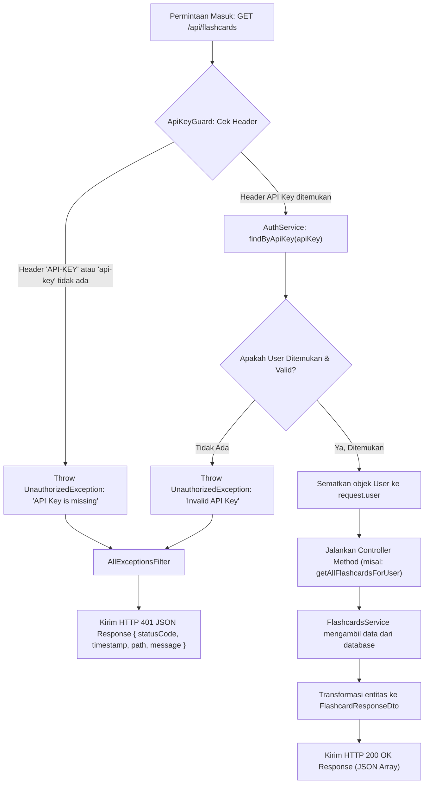
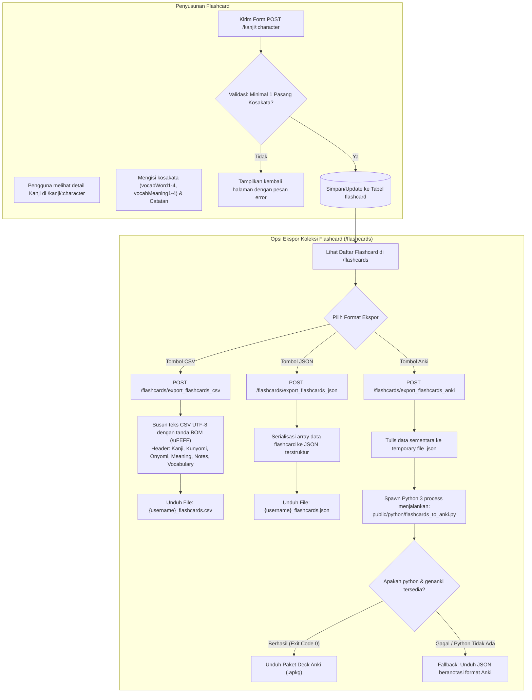
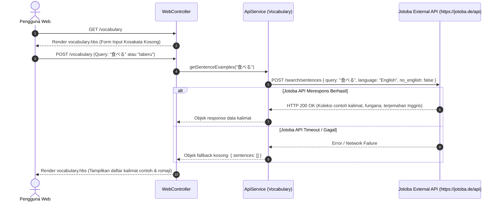

# 🌸 Kitsuno - Japanese Learning Platform (NestJS Edition)

[](https://nestjs.com/)
[](https://nodejs.org/)
[](https://www.typescriptlang.org/)
[](https://typeorm.io/)
[](http://localhost:3000/v1/api-docs)
[](LICENSE)

**Kitsuno** adalah platform pembelajaran bahasa Jepang yang komprehensif, intuitif, dan terintegrasi penuh. Proyek ini dibangun sebagai arsitektur monolit modern menggunakan **NestJS**, menggabungkan antarmuka web berbasis Server-Side Rendering (SSR Handlebars) yang interaktif serta REST API berkecepatan tinggi yang dilengkapi dokumentasi OpenAPI/Swagger dan autentikasi API Key.

Platform ini menyediakan modul pembelajaran lengkap untuk aksara **Hiragana**, **Katakana**, karakter **Kanji (Grade 1 hingga 7+)**, **Partikel Tata Bahasa (Particles)**, pencarian kalimat contoh dari **Jotoba API**, hingga sistem **Flashcard Pribadi** dengan dukungan ekspor multi-format (CSV, JSON, dan kartu Anki `.apkg` via Python `genanki`).

---

## 📑 Daftar Isi

1. [Teknologi & Tech Stack](#-teknologi--tech-stack)
2. [Struktur Direktori Aplikasi](#-struktur-direktori-aplikasi)
3. [Arsitektur & Flowchart Sistem](#-arsitektur--flowchart-sistem)
   - [Arsitektur Tingkat Tinggi](#1-arsitektur-tingkat-tinggi-high-level-architecture)
   - [Alur Autentikasi Pengguna & Sesi Web](#2-alur-autentikasi-pengguna--sesi-web)
   - [Siklus Hidup Permintaan REST API](#3-siklus-hidup-permintaan-rest-api-api-key)
   - [Alur Manajemen Flashcard & Ekspor](#4-alur-manajemen-flashcard--ekspor)
   - [Integrasi Pencarian Kosakata (Jotoba API)](#5-integrasi-pencarian-kosakata-jotoba-api)
4. [Struktur Database & Model Relasi (ERD)](#-struktur-database--model-relasi-erd)
   - [Diagram Hubungan Entitas (ERD)](#diagram-hubungan-entitas-erd)
   - [Detail Tabel Database](#detail-tabel-database)
   - [Mekanisme Otomatisasi Seeding Data](#mekanisme-otomatisasi-seeding-data)
5. [Konfigurasi & Koneksi Database (Multi-Driver)](#-konfigurasi--koneksi-database-multi-driver)
6. [Arsitektur Frontend (SSR & Interaktivitas)](#-arsitektur-frontend-ssr--interaktivitas)
   - [Handlebars Template Engine & Helpers](#handlebars-template-engine--helpers)
   - [Katalog Halaman & Fitur Interaktif](#katalog-halaman--fitur-interaktif)
   - [Game Interaktif Latihan Aksara (Practice Game)](#game-interaktif-latihan-aksara-practice-game)
7. [Arsitektur Backend (Modul, Layanan & Keamanan)](#-arsitektur-backend-modul-layanan--keamanan)
   - [Struktur Modul NestJS](#struktur-modul-nestjs)
   - [Lapisan Keamanan & Guards](#lapisan-keamanan--guards)
   - [Global Filter & Penanganan Error](#global-filter--penanganan-error)
8. [Dokumentasi Lengkap API (REST Endpoints)](#-dokumentasi-lengkap-api-rest-endpoints)
   - [Spesifikasi Swagger UI](#spesifikasi-swagger-ui)
   - [Characters API](#characters-api)
   - [Particles API](#particles-api)
   - [Flashcards API](#flashcards-api)
   - [Web Endpoints (SSR)](#web-endpoints-ssr)
9. [Panduan Menjalankan Proyek (Step-by-Step)](#-panduan-menjalankan-proyek-step-by-step)
   - [Prasyarat Sistem](#prasyarat-sistem)
   - [Langkah Instalasi & Setup](#langkah-instalasi--setup)
   - [Akun Demo Bawaan (Default User)](#akun-demo-bawaan-default-user)
10. [Troubleshooting & FAQ](#-troubleshooting--faq)

---

## 🛠 Teknologi & Tech Stack

Proyek ini memanfaatkan ekosistem modern Node.js dan TypeScript untuk menjamin performa tinggi, modularitas, dan skalabilitas:

| Kategori | Teknologi / Paket | Versi | Rationale & Fungsi |
| :--- | :--- | :--- | :--- |
| **Framework Inti** | [NestJS](https://nestjs.com/) (`@nestjs/core`, `@nestjs/common`) | `^11.0.1` | Arsitektur modular bergaya enterprise dengan Dependency Injection, routing, dan decorator deklaratif. |
| **Runtime & Bahasa** | [Node.js](https://nodejs.org/) & [TypeScript](https://www.typescriptlang.org/) | Node `v20+` / TS `^5.7.3` | Type-safety penuh dari entitas, DTO, controller, hingga logic layanan. |
| **HTTP Server Adapter**| `@nestjs/platform-express` | `^11.0.1` | Lapisan Express untuk menangani HTTP request, middleware, session, dan static assets. |
| **Database & ORM** | [TypeORM](https://typeorm.io/) & `@nestjs/typeorm` | `^0.3.20` / `^11.0.0` | ORM fleksibel berbasis Active Record / Data Mapper yang mendukung multi-driver (SQLite & Postgres). |
| **Database Driver** | `better-sqlite3` & `sqlite3` | `^13.0.3` / `^5.1.7` | Driver SQLite super-cepat C++ binding (zero-config, self-contained untuk development/local). |
| **Database Driver** | `pg` (PostgreSQL) | `^8.13.1` | Driver PostgreSQL enterprise-ready untuk skenario deployment multi-node. |
| **Template Engine** | [Handlebars](https://handlebarsjs.com/) (`hbs`) | `^4.2.0` | Server-Side Rendering (SSR) dinamis, ringan, dan mudah dikustomisasi dengan custom helpers. |
| **Autentikasi Sesi** | `passport`, `passport-local`, `express-session` | `^0.7.0` / `^1.18.1` | Autentikasi sesi berbasis cookie terenkripsi untuk antarmuka web. |
| **Kriptografi & Hashing**| `bcrypt` & `bcryptjs` | `^5.1.1` / `^3.0.3` | Pengacakan (hashing) dan verifikasi password pengguna menggunakan salted rounds aman. |
| **Validasi Data** | `class-validator` & `class-transformer` | `^0.14.1` / `^0.5.1` | Validasi DTO otomatis pada payload request body dengan pesan kesalahan yang jelas. |
| **Dokumentasi API** | `@nestjs/swagger` & `swagger-ui-express` | `^11.0.3` / `^5.0.1` | Generator otomatis dokumentasi OpenAPI 3.0 interaktif dan UI Swagger terintegrasi. |
| **External Service (Email)**| [Resend SDK](https://resend.com/) | `^4.1.1` | Layanan pengiriman email transaksional untuk verifikasi registrasi akun (dengan console fallback). |
| **External API (Dictionary)**| [Jotoba API](https://jotoba.de/) via `axios` | `^1.7.9` | Mesin pencarian kalimat contoh bahasa Jepang-Inggris dan referensi kosakata kontekstual. |
| **Integrasi Anki (Flashcard)**| Python 3 (`genanki`) | - | Script pembantu Python untuk mengonversi database flashcard menjadi file deck Anki siap pakai (`.apkg`). |
| **Package Manager** | `pnpm` (Corepack) | `12.x` | Manajemen dependensi berbasis symlink cepat, hemat disk, dan deterministik. |

---

## 📂 Struktur Direktori Aplikasi

Berikut adalah struktur hirarki berkas dan folder dari proyek Kitsuno:

```text
kitsuno-tapi-nest-js-sqlite/
├── .agents/                        # Konfigurasi agen AI & skill otomasi
├── dist/                           # Hasil kompilasi TypeScript (target build produksi)
├── extras/                         # Skrip pelengkap dan utilitas migrasi
├── public/                         # Berkas statis (CSS, JS, Gambar, Skrip Python)
│   ├── css/                        # Berkas stylesheet utama
│   │   ├── styles.css              # Styling global aplikasi web
│   │   └── welcome.css             # Styling khusus landing page
│   ├── images/                     # Asset grafis dan ilustrasi
│   │   ├── favicon/                # Ikon tab peramban (32x32, 64x64)
│   │   ├── flashcards/             # Ikon tombol ekspor (Anki, CSV, JSON)
│   │   ├── kanji/                  # Ikon panah & elemen visual kanji
│   │   ├── navbar/                 # Ikon navigasi menu bar
│   │   ├── profile/                # Ikon avatar profil pengguna
│   │   ├── vocabulary/             # Ikon modul pencarian kosakata
│   │   └── welcome/                # Maskot kitsune, logo, dan diagram landing page
│   ├── js/                         # Skrip JavaScript sisi klien (browser)
│   │   ├── practice-game.js        # Logika kuis tebak karakter Hiragana/Katakana
│   │   ├── script.js               # Event listener navigasi, modal, & animasi umum
│   │   └── welcome.js              # Animasi scroll halus pada landing page
│   └── python/                     # Skrip python untuk integrasi pihak ketiga
│       └── flashcards_to_anki.py   # Pembuat deck file Anki .apkg menggunakan paket genanki
├── src/                            # Kode sumber aplikasi NestJS (TypeScript)
│   ├── entities/                   # Entitas database TypeORM
│   │   ├── flashcard.entity.ts     # Entitas kartu flashcard milik user
│   │   ├── hiragana.entity.ts      # Entitas aksara Hiragana & mnemonic
│   │   ├── index.ts                # Barrel export untuk seluruh entitas
│   │   ├── kanji.entity.ts         # Entitas karakter Kanji, goresan, & bacaan
│   │   ├── katakana.entity.ts      # Entitas aksara Katakana & mnemonic
│   │   ├── particle.entity.ts      # Entitas partikel tata bahasa Jepang
│   │   └── user.entity.ts          # Entitas akun user, password hash, & API Key
│   ├── filters/                    # Filter pengecualian (Exception Filters)
│   │   └── all-exceptions.filter.ts# Pembeda penanganan error: JSON untuk API & SSR untuk Web
│   ├── modules/                    # Modul-modul fitur NestJS
│   │   ├── auth/                   # Modul autentikasi, sesi web & API Key
│   │   │   ├── dto/                # Data Transfer Objects untuk login, register, update profile
│   │   │   ├── guards/             # Guards: LocalAuthGuard, AuthenticatedGuard, ApiKeyGuard
│   │   │   ├── strategies/         # Passport Strategy (LocalStrategy)
│   │   │   ├── auth.controller.ts  # Web Controller untuk /login, /register, /logout, /verify
│   │   │   ├── auth.module.ts      # Definisi modul autentikasi
│   │   │   ├── auth.service.ts     # Logika bisnis autentikasi, verifikasi, & hash password
│   │   │   └── session.serializer.ts # Serialisasi user id ke dalam sesi Express
│   │   ├── characters/             # Modul aksara Kana dan karakter Kanji
│   │   │   ├── utils/              # KanaUtils (format kolom tabel & varian dakuten/yoon)
│   │   │   ├── characters.controller.ts # REST API untuk Hiragana, Katakana, dan Kanji
│   │   │   ├── characters.module.ts# Definisi modul aksara
│   │   │   ├── hiragana.service.ts # Layanan data Hiragana
│   │   │   ├── kanji.service.ts    # Layanan data Kanji (filter grade, ID, pencarian)
│   │   │   └── katakana.service.ts # Layanan data Katakana
│   │   ├── database/               # Modul manajemen database
│   │   │   ├── database.module.ts  # Injeksi repositori untuk seeder
│   │   │   └── seeder.service.ts   # Otomatisasi seeding data awal (Kana, Kanji, Partikel, User Demo)
│   │   ├── email/                  # Modul integrasi email transaksional
│   │   │   ├── email.module.ts     # Injeksi konfigurasi email
│   │   │   └── email.service.ts    # Integrasi Resend API & fallback logger lokal
│   │   ├── flashcards/             # Modul flashcard pribadi pengguna
│   │   │   ├── dto/                # FlashcardDto & FlashcardResponseDto
│   │   │   ├── flashcard-web.controller.ts # Web Controller untuk /flashcards & ekspor file
│   │   │   ├── flashcards.controller.ts    # REST API CRUD untuk /api/flashcards
│   │   │   ├── flashcards.module.ts# Definisi modul flashcards
│   │   │   └── flashcards.service.ts# Logika bisnis penyimpanan, relasi kanji, & ekspor
│   │   ├── particles/              # Modul partikel tata bahasa Jepang
│   │   │   ├── particles.controller.ts # REST API /api/particles
│   │   │   ├── particles.module.ts # Definisi modul partikel
│   │   │   └── particles.service.ts# Layanan pengambilan data partikel
│   │   ├── vocabulary/             # Modul integrasi pencarian kosakata eksternal
│   │   │   ├── api.service.ts      # Klien Axios untuk Jotoba API (/search/sentences)
│   │   │   └── vocabulary.module.ts# Definisi modul vocabulary
│   │   └── web/                    # Modul tampilan web SSR umum & profil
│   │       ├── profile.controller.ts # Tampilan & form ubah username, password, generate API Key
│   │       ├── web.controller.ts   # Tampilan welcome, kana, kanji detail, partikel, & tentang
│   │       └── web.module.ts       # Definisi modul web SSR
│   ├── app.module.ts               # Root module (konfigurasi ConfigModule & TypeORM)
│   └── main.ts                     # Titik masuk utama aplikasi (bootstrap, HBS helpers, Swagger)
├── views/                          # Berkas template antarmuka Handlebars (.hbs)
│   ├── about.hbs                   # Halaman Tentang Kitsuno
│   ├── error.hbs                   # Halaman penanganan error 404/500 ramah pengguna
│   ├── flashcard.hbs               # Halaman koleksi flashcard & tombol unduh CSV/JSON/Anki
│   ├── hiragana.hbs                # Tabel interaktif Hiragana beserta audio & stroke order
│   ├── hiragana-practice.hbs       # Arena latihan tebak romaji Hiragana
│   ├── kanji.hbs                   # Galeri kanji yang dikelompokkan berdasarkan Grade (1-7+)
│   ├── kanji-details.hbs           # Lembar rincian Kanji & form tambah ke flashcard
│   ├── katakana.hbs                # Tabel interaktif Katakana beserta audio & stroke order
│   ├── katakana-practice.hbs       # Arena latihan tebak romaji Katakana
│   ├── login.hbs                   # Form masuk pengguna
│   ├── logout.hbs                  # Halaman konfirmasi keluar sistem
│   ├── particles.hbs               # Panduan komprehensif partikel Jepang (fungsi & contoh kalimat)
│   ├── privacypolicy.hbs           # Halaman Kebijakan Privasi
│   ├── profile.hbs                 # Dasbor profil, status API Key, & manajemen akun
│   ├── register.hbs                # Form pendaftaran akun baru
│   ├── resend-verification.hbs     # Form kirim ulang tautan verifikasi email
│   ├── tos.hbs                     # Halaman Syarat & Ketentuan Layanan (ToS)
│   ├── verify.hbs                  # Halaman status aktivasi akun sukses/gagal
│   ├── vocabulary.hbs              # Mesin pencari contoh kalimat dan arti kosakata
│   └── welcome.hbs                 # Landing page beranda utama
├── .env.example                    # Template variabel konfigurasi lingkungan
├── kitsuno.sqlite                  # Berkas basis data SQLite bawaan
├── nest-cli.json                   # Konfigurasi build Nest CLI
├── package.json                    # Deklarasi dependensi & skrip npm/pnpm
├── pnpm-lock.yaml                  # Kunci dependensi pnpm deterministik
├── tsconfig.json                   # Konfigurasi compiler TypeScript
└── tsconfig.build.json             # Konfigurasi spesifik build kompilasi
```

---

## 🔄 Arsitektur & Flowchart Sistem

### 1. Arsitektur Tingkat Tinggi (High-Level Architecture)

Aplikasi Kitsuno mengadopsi pola arsitektur **Hybrid SSR & REST API**:

```mermaid
flowchart TD
    ClientBrowser["🌐 Peramban Pengguna (Browser)"]
    ExternalDev["💻 Aplikasi Klien / Pengembang Eksternal"]

    subgraph KitsunoApp["🚀 Aplikasi NestJS (Port: 3000)"]
        GlobalMiddleware["Express Session & Passport Middleware"]
        GlobalPipes["ValidationPipe (class-validator)"]
        GlobalFilter["AllExceptionsFilter"]

        subgraph SSRLayer["🖥️ Lapisan Web SSR"]
            WebCtrl["WebController / ProfileController / AuthController"]
            HbsEngine["Handlebars Engine (.hbs views)"]
            StaticAssets["Public Assets (CSS, JS, Audio, SVG)"]
        end

        subgraph APILayer["⚡ Lapisan REST API (/api)"]
            ApiKeySec["ApiKeyGuard (Header: API-KEY)"]
            SwaggerDoc["Swagger / OpenAPI Docs (/v1/api-docs)"]
            CharCtrl["CharactersController"]
            FlashCtrl["FlashcardsController"]
            PartCtrl["ParticlesController"]
        end

        subgraph ServiceLayer["⚙️ Lapisan Layanan Bisnis (Services)"]
            AuthSvc["AuthService"]
            CharSvc["Hiragana / Katakana / Kanji Service"]
            FlashSvc["FlashcardsService"]
            PartSvc["ParticlesService"]
            VocabSvc["ApiService (Jotoba Client)"]
            EmailSvc["EmailService (Resend)"]
            SeederSvc["SeederService (onApplicationBootstrap)"]
        end

        subgraph DataAccessLayer["💾 Lapisan Akses Data (TypeORM)"]
            TypeOrmMod["TypeOrmModule.forRootAsync()"]
            Repositories["Repositories: User, Kanji, Kana, Flashcard, Particle"]
        end
    end

    subgraph ExternalServices["🌍 Layanan Eksternal & Pihak Ketiga"]
        JotobaAPI["Jotoba API (https://jotoba.de/api)"]
        ResendAPI["Resend Email API"]
        PythonGenanki["Python 3 Script (genanki Anki Generator)"]
    end

    subgraph Storage["🗄️ Basis Data"]
        SQLiteDB[("SQLite (kitsuno.sqlite)")]
        PostgresDB[("PostgreSQL Database")]
    end

    ClientBrowser -->|HTTP GET/POST (Cookies/Session)| GlobalMiddleware
    ExternalDev -->|REST HTTP (Header: API-KEY)| ApiKeySec

    GlobalMiddleware --> GlobalPipes --> WebCtrl
    ApiKeySec --> GlobalPipes --> APILayer

    WebCtrl --> HbsEngine
    HbsEngine --> ClientBrowser
    WebCtrl --> ServiceLayer
    APILayer --> ServiceLayer

    VocabSvc -->|HTTP POST| JotobaAPI
    EmailSvc -->|HTTP POST| ResendAPI
    FlashSvc -.->|Child Process spawn| PythonGenanki

    ServiceLayer --> Repositories --> TypeOrmMod
    TypeOrmMod -->|better-sqlite3| SQLiteDB
    TypeOrmMod -.->|pg driver| PostgresDB
    GlobalFilter -.->|Render error.hbs atau JSON| ClientBrowser
```

---

### 2. Alur Autentikasi Pengguna & Sesi Web

Diagram berikut menjelaskan siklus registrasi, verifikasi email, login berbasis sesi cookie, dan pengelolaan profil:

```mermaid
sequenceDiagram
    autonumber
    actor User as Pengguna (Browser)
    participant AuthCtrl as AuthController
    participant AuthSvc as AuthService
    participant EmailSvc as EmailService
    participant DB as Basis Data (TypeORM)
    participant Session as Express Session Store

    %% Registrasi
    rect rgb(240, 248, 255)
    Note over User, DB: Proses Registrasi Akun Baru
    User->>AuthCtrl: POST /register { username, email, password, confirmPassword }
    AuthCtrl->>AuthSvc: register(registerDto)
    AuthSvc->>DB: Cek keunikan email & username
    AuthSvc->>AuthSvc: Hash password dengan bcrypt (10 rounds) & buat token acak (UUID hex)
    AuthSvc->>DB: Simpan User baru (enabled: false)
    AuthSvc->>EmailSvc: sendVerificationEmail(email, token)
    EmailSvc-->>User: Kirim email berisi link: /verify?token=XYZ
    AuthCtrl-->>User: Redirect ke /login (Pesan: Periksa email Anda)
    end

    %% Verifikasi Email
    rect rgb(245, 255, 245)
    Note over User, DB: Proses Verifikasi Email
    User->>AuthCtrl: GET /verify?token=XYZ
    AuthCtrl->>AuthSvc: verifyUser(token)
    AuthSvc->>DB: Cari user berdasarkan verification_token
    AuthSvc->>DB: Update user (enabled: true, verificationToken: null)
    AuthCtrl-->>User: Render verify.hbs ("Selamat, akun telah terverifikasi!")
    end

    %% Login
    rect rgb(255, 250, 240)
    Note over User, DB: Proses Masuk (Login) Sesi Sisi Klien
    User->>AuthCtrl: POST /login { username, password } via LocalAuthGuard
    AuthCtrl->>AuthSvc: validateUser(username, password)
    AuthSvc->>DB: Cari user berdasarkan username (cek enabled == true)
    AuthSvc->>AuthSvc: bcrypt.compare(password, user.password)
    AuthSvc-->>AuthCtrl: Berhasil validasi user
    AuthCtrl->>Session: Simpan user.id ke dalam session cookie (Passport serializeUser)
    AuthCtrl-->>User: Redirect ke /vocabulary (Cookie terpasang)
    end

    %% Akses Halaman Terproteksi
    rect rgb(255, 245, 245)
    Note over User, DB: Akses Profil & Regenerasi API Key
    User->>AuthCtrl: GET /profile (Kirim Cookie Sesi)
    AuthCtrl->>Session: Deserialize user.id dari session
    AuthCtrl->>DB: Ambil detail User & hitung total Flashcard
    AuthCtrl-->>User: Render profile.hbs (Menampilkan API Key)
    User->>AuthCtrl: GET /updateApiKey
    AuthCtrl->>AuthSvc: updateApiKey(user)
    AuthSvc->>DB: Buat UUID v4 baru dan simpan sebagai api_key
    AuthCtrl-->>User: Redirect /profile (API Key terbarukan)
    end
```



---

### 3. Siklus Hidup Permintaan REST API (`ApiKeyGuard`)

Setiap permintaan yang ditujukan ke endpoint `/api/*` harus melalui pengawalan `ApiKeyGuard`:



---

### 4. Alur Manajemen Flashcard & Ekspor

Pengguna dapat menyusun flashcard kustom dari karakter Kanji yang dipelajari dan mengekspornya ke berbagai format:



---

### 5. Integrasi Pencarian Kosakata (Jotoba API)

Untuk membantu pembelajar memahami konteks penggunaan kata dalam kalimat nyata bahasa Jepang:



---

## 🗄 Struktur Database & Model Relasi (ERD)

Aplikasi menggunakan TypeORM untuk mengelola pemetaan objek-relasional. Skema database dirancang untuk mendukung pembelajaran karakter, relasi pengguna dengan kartu latihan, dan partikel tata bahasa.

### Diagram Hubungan Entitas (ERD)

```mermaid
erDiagram
    USERS ||--o{ FLASHCARD : "memiliki banyak (1:N)"
    KANJI ||--o{ FLASHCARD : "direferensikan oleh (1:N)"

    USERS {
        int id PK "Auto Increment"
        varchar username "Unique, max 14 char"
        varchar email "Unique"
        varchar password "Bcrypt hash"
        varchar join_date "Tanggal bergabung (YYYY-MM-DD)"
        varchar api_key "Unique, UUID v4 token"
        boolean enabled "Status aktivasi verifikasi email"
        varchar verification_token "Token unik 64 char verifikasi"
    }

    KANJI {
        int id PK "Auto Increment"
        varchar character "Karakter Kanji tunggal (e.g. 日)"
        int stroke_count "Jumlah goresan kuas"
        int grade "Tingkat kelas sekolah (1 - 7)"
        text meanings "Arti/terjemahan bahasa Inggris"
        text onyomi_readings "Simple-array (e.g. ニチ, ジツ)"
        text kunyomi_readings "Simple-array (e.g. ひ, -び)"
        text stroke_order_svg "Markup SVG diagram urutan goresan"
        text vocab "Simple-array contoh kosakata & bacaan"
    }

    FLASHCARD {
        int id PK "Auto Increment"
        int user_id FK "Relasi ke tabel USERS (CASCADE ON DELETE)"
        int kanji_id FK "Relasi ke tabel KANJI (CASCADE ON DELETE)"
        text vocabulary "Simple-array kata & arti yang dicatat user"
        text notes "Catatan personal atau trik hafalan (max 200)"
    }

    HIRAGANA {
        int id PK "Auto Increment"
        varchar character "Aksara Hiragana (e.g. あ)"
        varchar romaji "Romanisasi alfabet (e.g. a)"
        varchar audio "Tautan URL audio pelafalan mp3"
        varchar mnemonic "Deskripsi singkat asosiasi visual"
        varchar story "Cerita visual pembantu ingatan"
        varchar stroke_order "Nama berkas SVG urutan goresan"
    }

    KATAKANA {
        int id PK "Auto Increment"
        varchar character "Aksara Katakana (e.g. ア)"
        varchar romaji "Romanisasi alfabet (e.g. a)"
        varchar audio "Tautan URL audio pelafalan mp3"
        varchar mnemonic "Deskripsi singkat asosiasi visual"
        varchar story "Cerita visual pembantu ingatan"
        varchar stroke_order "Nama berkas SVG urutan goresan"
    }

    PARTICLE {
        int id PK "Auto Increment"
        varchar particle "Nama partikel (e.g. は (wa))"
        varchar meaning "Fungsi utama partikel"
        text description "Penjelasan mendalam aturan penggunaan"
        text formation "Pola rumus susunan tata bahasa"
        text example "Contoh kalimat Jepang, kanji, & terjemahan"
    }
```



---

### Detail Tabel Database

#### 1. Tabel `users`
Menyimpan akun pengguna, kredensial autentikasi, status verifikasi email, dan API key unik.
- **`id`** (`integer`, Primary Key, Auto Increment): ID unik pengguna.
- **`username`** (`varchar(14)`, Not Null, Unique): Nama pengguna untuk login dan tampilan profil.
- **`email`** (`varchar`, Not Null, Unique): Alamat email terdaftar untuk verifikasi akun.
- **`password`** (`varchar`, Not Null): Kata sandi yang telah di-hash dengan Bcrypt.
- **`join_date`** (`varchar(20)`, Not Null): Tanggal akun dibuat (`YYYY-MM-DD`), diisi otomatis via `@BeforeInsert()`.
- **`api_key`** (`varchar`, Nullable, Unique): Kunci rahasia untuk autentikasi REST API.
- **`enabled`** (`boolean`, Default: `false`): Menandakan apakah email telah diverifikasi.
- **`verification_token`** (`varchar(64)`, Nullable, Unique): Token acak 64 karakter saat proses verifikasi email.

#### 2. Tabel `kanji`
Menyimpan perbendaharaan karakter Kanji Jepang lengkap dari tingkat dasar hingga mahir.
- **`id`** (`integer`, Primary Key, Auto Increment): ID karakter Kanji.
- **`character`** (`varchar`, Not Null): Karakter Kanji fisik (misal: `日`, `本`, `愛`).
- **`stroke_count`** (`integer`, Default: `0`): Jumlah goresan kuas menulis kanji tersebut.
- **`grade`** (`integer`, Default: `1`): Tingkatan kelas (Grade 1 hingga Grade 7+ SMP/SMA).
- **`meanings`** (`text`, Nullable): Terjemahan makna karakter dalam bahasa Inggris.
- **`onyomi_readings`** (`simple-array`, Nullable): Pembacaan On'yomi (cara baca Cina, katakana).
- **`kunyomi_readings`** (`simple-array`, Nullable): Pembacaan Kun'yomi (cara baca Jepang asli, hiragana).
- **`stroke_order_svg`** (`text`, Nullable): Kode SVG visual animasi/diagram goresan kuas.
- **`vocab`** (`simple-array`, Nullable): Daftar kosakata contoh standar yang memakai kanji ini.

#### 3. Tabel `flashcard`
Menyimpan catatan personal belajar kanji dan kosakata yang disusun sendiri oleh pengguna.
- **`id`** (`integer`, Primary Key, Auto Increment): ID kartu flashcard.
- **`user_id`** (`integer`, Foreign Key -> `users.id`, `onDelete: 'CASCADE'`): Pemilik flashcard.
- **`kanji_id`** (`integer`, Foreign Key -> `kanji.id`, `onDelete: 'CASCADE'`): Kanji yang dipelajari.
- **`vocabulary`** (`simple-array`, Nullable): Array pasangan kata dan arti yang disimpan user (maksimal 4 pasang).
- **`notes`** (`text`, Nullable): Catatan pengingat tambahan (maksimal 200 karakter).

#### 4. Tabel `hiragana` & `katakana`
Menyimpan 46 aksara dasar suku kata Jepang beserta panduan mnemonik memori visual dan audio pengucapan.
- **`id`** (`integer`, Primary Key, Auto Increment): ID karakter.
- **`character`** (`varchar`): Aksara fisik Jepang (misal: `あ` atau `ア`).
- **`romaji`** (`varchar`): Transkripsi abjad latin (misal: `a`, `ka`, `shi`).
- **`audio`** (`varchar`): URL file audio pelafalan pengucap penutur asli (Tofugu assets).
- **`mnemonic`** (`varchar`): Frasa asosiasi visual cepat (misal: *"An apple with a stem"*).
- **`story`** (`varchar`): Cerita visual pembantu asosiasi bentuk karakter.
- **`stroke_order`** (`varchar`): Nama berkas vektor SVG diagram urutan goresan kuas.

#### 5. Tabel `particle`
Menyimpan panduan lengkap partikel gramatikal bahasa Jepang (Joshi).
- **`id`** (`integer`, Primary Key, Auto Increment): ID partikel.
- **`particle`** (`varchar`): Lambang dan bunyi partikel (misal: `は (wa)`, `が (ga)`, `を (o)`).
- **`meaning`** (`varchar`): Peran gramatikal (misal: *topic marker*, *subject marker*).
- **`description`** (`text`): Penjelasan mendetail kapan dan bagaimana partikel digunakan.
- **`formation`** (`text`): Rumus struktur kalimat sintaksis.
- **`example`** (`text`): Contoh kalimat lengkap dalam kanji, romaji, dan bahasa Inggris.

---

### Mekanisme Otomatisasi Seeding Data

Aplikasi memiliki layanan khusus [`SeederService`](file:///home/minipingu/Desktop/kitsuno-tapi-nest-js-sqlite/src/modules/database/seeder.service.ts) yang mengimplementasikan lifecycle interface `OnApplicationBootstrap`.

Saat server NestJS dinyalakan pertama kali:
1. Mengecek jumlah baris tabel `hiragana`. Jika kosong, menyemai **46 aksara Hiragana** dasar beserta link audio dan cerita mnemonik.
2. Mengecek jumlah baris tabel `katakana`. Jika kosong, menyemai **46 aksara Katakana** dasar.
3. Mengecek tabel `kanji`. Jika kosong, menyemai puluhan karakter Kanji Grade 1 sampai Grade 7 dengan SVG goresan kuas dan kosakata.
4. Mengecek tabel `particle`. Jika kosong, menyemai **15 partikel gramatikal utama** Jepang (wa, ga, o, ni, de, e, to, mo, kara, made, yori, ne, yo, ka, no).
5. Mengecek keberadaan user default: `demo`. Jika belum ada, membuat akun demo yang telah aktif (`enabled: true`) beserta 3 flashcard kanji bawaan.

---

## 🔌 Konfigurasi & Koneksi Database (Multi-Driver)

Kitsuno dirancang dengan fleksibilitas multi-database melalui abstraksi TypeORM di [`src/app.module.ts`](file:///home/minipingu/Desktop/kitsuno-tapi-nest-js-sqlite/src/app.module.ts). Anda dapat beralih antara SQLite dan PostgreSQL cukup dengan mengubah nilai variabel lingkungan di file `.env`.

### 1. Mode SQLite (Standar / Zero-Config)
Cocok untuk pengembangan lokal, pengujian langsung di laptop, atau demonstrasi tanpa perlu menginstal server database tambahan.

```ini
# Konfigurasi di berkas .env
DB_TYPE=sqlite
DATABASE_TYPE=sqlite
DATABASE_FILE=kitsuno.sqlite
```

Implementasi di balik layar:
```typescript
return {
  type: 'better-sqlite3',
  database: config.get<string>('DATABASE_FILE', 'kitsuno.sqlite'),
  entities: [User, Hiragana, Katakana, Kanji, Particle, Flashcard],
  synchronize: true, // Membuat/menyesuaikan tabel secara otomatis
  autoLoadEntities: true,
};
```

### 2. Mode PostgreSQL (Produksi / Cloud)
Cocok untuk lingkungan produksi, kontainer Docker, atau deployment cloud yang memerlukan konkurensi tinggi.

```ini
# Konfigurasi di berkas .env
DB_TYPE=postgres
DATABASE_TYPE=postgres
DB_HOST=localhost
DB_PORT=5432
DB_USERNAME=postgres
DB_PASSWORD=postgres
DB_NAME=kitsuno
```

Implementasi di balik layar:
```typescript
return {
  type: 'postgres',
  host: config.get<string>('DB_HOST', 'localhost'),
  port: parseInt(config.get<string>('DB_PORT', '5432'), 10),
  username: config.get<string>('DB_USERNAME', 'postgres'),
  password: config.get<string>('DB_PASSWORD', 'postgres'),
  database: config.get<string>('DB_NAME', 'kitsuno'),
  entities: [User, Hiragana, Katakana, Kanji, Particle, Flashcard],
  synchronize: true,
  autoLoadEntities: true,
};
```

---

## 🎨 Arsitektur Frontend (SSR & Interaktivitas)

Antarmuka web Kitsuno dibangun menggunakan **Server-Side Rendering (SSR)** dengan mesin template **Handlebars (`hbs`)**, dipadukan dengan styling kustom CSS vanilla murni dan JavaScript sisi peramban.

### Handlebars Template Engine & Helpers

Semua view tersimpan di direktori `views/` dan dikonfigurasikan di [`src/main.ts`](file:///home/minipingu/Desktop/kitsuno-tapi-nest-js-sqlite/src/main.ts). Berbagai helper kustom telah didaftarkan untuk memudahkan manipulasi tampilan:

| Nama Helper | Argumen | Fungsi |
| :--- | :--- | :--- |
| `json` | `(context)` | Mengonversi objek JavaScript ke string JSON untuk disematkan ke atribut HTML atau `<script>`. |
| `join` | `(arr, sep)` | Menggabungkan array menjadi teks dengan pemisah kustom (default: `, `). |
| `vocabWord` | `(item)` | Mengekstrak bagian kata & kanji dari format string database `漢字 【かんじ】arti` (mengambil hingga tanda `】`). |
| `vocabMeaning`| `(item)` | Mengekstrak bagian arti bahasa Inggris dari format string database (mengambil setelah tanda `】`). |
| `particleExJp`| `(item)` | Mengekstrak bagian kalimat Jepang pada contoh kalimat partikel. |
| `particleExEn`| `(item)` | Mengekstrak bagian terjemahan kalimat bahasa Inggris pada contoh partikel. |
| `formatDate` | `(dateStr)` | Memformat string ISO tanggal menjadi format tanggal lokal yang ramah dibaca (`toLocaleDateString`). |
| `eq` / `ne` | `(a, b)` | Komparasi kesetaraan nilai (`a === b` atau `a !== b`). |
| `not` | `(a)` | Negasi logika boolean (`!a`). |
| `and` / `or` | `(a, b)` | Operasi logika AND (`a && b`) dan OR (`a || b`). |

---

### Katalog Halaman & Fitur Interaktif

| Halaman & Rute | Template File | Fungsi Utama & Interaktivitas |
| :--- | :--- | :--- |
| **Landing Page** (`/`) | [`welcome.hbs`](file:///home/minipingu/Desktop/kitsuno-tapi-nest-js-sqlite/views/welcome.hbs) | Menampilkan pengenalan platform, tombol CTA cerdas (berubah otomatis tergantung status login), dan navigasi dropdown eksplorasi. |
| **Hiragana Gallery** (`/hiragana`) | [`hiragana.hbs`](file:///home/minipingu/Desktop/kitsuno-tapi-nest-js-sqlite/views/hiragana.hbs) | Matriks tabel aksara 46 Hiragana + varian Dakuten/Yoon. Dilengkapi pemutar audio pelafalan asli dan modal diagram urutan goresan. |
| **Hiragana Quiz** (`/practice-hiragana`)| [`hiragana-practice.hbs`](file:///home/minipingu/Desktop/kitsuno-tapi-nest-js-sqlite/views/hiragana-practice.hbs) | Game kuis tebak suara/aksara ke romaji secara dinamis dengan pelacak skor benar/salah realtime. |
| **Katakana Gallery** (`/katakana`) | [`katakana.hbs`](file:///home/minipingu/Desktop/kitsuno-tapi-nest-js-sqlite/views/katakana.hbs) | Matriks tabel aksara 46 Katakana + varian Dakuten/Yoon lengkap dengan audio dan SVG goresan. |
| **Katakana Quiz** (`/practice-katakana`)| [`katakana-practice.hbs`](file:///home/minipingu/Desktop/kitsuno-tapi-nest-js-sqlite/views/katakana-practice.hbs) | Game kuis tebak romaji khusus aksara Katakana dengan umpan balik visual instan. |
| **Kanji Gallery** (`/kanji`) | [`kanji.hbs`](file:///home/minipingu/Desktop/kitsuno-tapi-nest-js-sqlite/views/kanji.hbs) | Menampilkan seluruh kanji yang dikelompokkan secara terstruktur berdasarkan Grade 1 s/d 7+. |
| **Kanji Detail** (`/kanji/:character`)| [`kanji-details.hbs`](file:///home/minipingu/Desktop/kitsuno-tapi-nest-js-sqlite/views/kanji-details.hbs) | Detail mendalam: goresan kuas SVG, arti, Kun'yomi, On'yomi, serta form untuk langsung menambahkan kanji tersebut ke Flashcard pribadi. |
| **Flashcard Deck** (`/flashcards`) | [`flashcard.hbs`](file:///home/minipingu/Desktop/kitsuno-tapi-nest-js-sqlite/views/flashcard.hbs) | Dasbor kartu hafalan milik pengguna. Dilengkapi tombol ekspor ke CSV, JSON, dan kartu Anki (`.apkg`). |
| **Vocabulary Search** (`/vocabulary`) | [`vocabulary.hbs`](file:///home/minipingu/Desktop/kitsuno-tapi-nest-js-sqlite/views/vocabulary.hbs) | Form pencarian kalimat contoh dari Jotoba API lengkap dengan pemisah kata dan translasi bahasa Inggris. |
| **Particles Guide** (`/particles`) | [`particles.hbs`](file:///home/minipingu/Desktop/kitsuno-tapi-nest-js-sqlite/views/particles.hbs) | Kartu referensi cepat 15 partikel gramatikal beserta rumus struktur dan contoh praktis. |
| **User Profile** (`/profile`) | [`profile.hbs`](file:///home/minipingu/Desktop/kitsuno-tapi-nest-js-sqlite/views/profile.hbs) | Dasbor akun: ubah username, ganti password, melihat jumlah flashcard tersimpan, serta mengelola/meregenerasi API Key. |
| **Autentikasi** (`/login`, `/register`, `/verify`, dll) | [`login.hbs`](file:///home/minipingu/Desktop/kitsuno-tapi-nest-js-sqlite/views/login.hbs), [`register.hbs`](file:///home/minipingu/Desktop/kitsuno-tapi-nest-js-sqlite/views/register.hbs) | Antarmuka registrasi akun, verifikasi email, login sesi, dan kirim ulang token verifikasi. |

---

### Game Interaktif Latihan Aksara (Practice Game)

Diimplementasikan pada [`public/js/practice-game.js`](file:///home/minipingu/Desktop/kitsuno-tapi-nest-js-sqlite/public/js/practice-game.js):
- Memetakan abjad romaji ke pasangan kana (`[hiragana, katakana]`).
- Mendeteksi konteks halaman secara otomatis via `document.title` (Hiragana vs Katakana).
- Memilih karakter acak dari kamus romaji.
- Memvalidasi input pengguna terhadap kunci romaji (case-insensitive & trim whitespace).
- Memberikan animasi warna hijau untuk jawaban benar dan merah untuk jawaban salah, lalu memperbarui counter skor secara realtime tanpa reload halaman.

---

## ⚙️ Arsitektur Backend (Modul, Layanan & Keamanan)

NestJS mengorganisasi aplikasi ke dalam unit-unit modul terisolasi (*cohesive modules*):

### Struktur Modul NestJS

1. **`AppModule`**: Modul akar (*root*) yang memuat konfigurasi variabel lingkungan secara global (`ConfigModule.forRoot`) dan inisialisasi koneksi basis data asinkron (`TypeOrmModule.forRootAsync`).
2. **`AuthModule`**:
   - Menangani siklus autentikasi pengguna: pendaftaran, pengacakan kata sandi dengan Bcrypt, verifikasi email, dan manajemen API Key.
   - Mengintegrasikan Passport dengan `LocalStrategy` untuk login form dan `SessionSerializer` untuk menyimpan identitas user di sesi Express.
3. **`CharactersModule`**:
   - Berisi `HiraganaService`, `KatakanaService`, dan `KanjiService`.
   - Mengelola pengambilan data aksara, pencarian berdasarkan ID/romaji/karakter, pengelompokan grade, dan penyusunan tata letak tabel aksara.
4. **`FlashcardsModule`**:
   - Menyediakan `FlashcardsService`, `FlashcardsController` (REST API), dan `FlashcardWebController` (Web SSR & Ekspor File).
   - Mengintegrasikan skrip Python `genanki` via `child_process.spawn` untuk konversi flashcard ke format Anki deck (`.apkg`).
5. **`ParticlesModule`**:
   - Menyediakan `ParticlesService` dan `ParticlesController` untuk mengambil seluruh daftar partikel tata bahasa.
6. **`VocabularyModule`**:
   - Membungkus integrasi eksternal ke Jotoba API via `ApiService` menggunakan Axios dengan penanganan timeout dan fallback yang aman.
7. **`EmailModule`**:
   - Menggunakan Resend SDK untuk mengirim email HTML verifikasi akun baru.
   - Menyediakan fallback pencatatan log (*warning log*) ke terminal jika `RESEND_API_KEY` tidak diisi (sangat ramah untuk development lokal).
8. **`DatabaseModule`**:
   - Membungkus `SeederService` untuk otomatisasi inisialisasi dataset aplikasi saat proses bootstrap selesai.
9. **`WebModule`**:
   - Mengelompokkan seluruh controller halaman SSR publik (`WebController`) dan halaman profil terproteksi (`ProfileController`).

---

### Lapisan Keamanan & Guards

Kitsuno menerapkan 3 mekanisme proteksi akses:

1. **`LocalAuthGuard` (`src/modules/auth/guards/local-auth.guard.ts`)**:
   - Menggunakan `AuthGuard('local')` dari `@nestjs/passport`.
   - Mencegat request `POST /login`, memverifikasi username dan password via `validateUser()`, dan memastikan akun telah diaktifkan (`enabled === true`).
2. **`AuthenticatedGuard` (`src/modules/auth/guards/authenticated.guard.ts`)**:
   - Melindungi rute web SSR (misal: `/profile`, `/flashcards`, `/updateUsername`).
   - Memeriksa `req.isAuthenticated()` dari session cookie. Jika belum login, otomatis mengalihkan (redirect) pengguna ke halaman `/login`.
3. **`ApiKeyGuard` (`src/modules/auth/guards/api-key.guard.ts`)**:
   - Melindungi seluruh endpoint REST API di `/api/*`.
   - Membaca header `API-KEY` atau `api-key`.
   - Melakukan validasi kunci ke database melalui `AuthService.findByApiKey(apiKey)`.
   - Melempar `UnauthorizedException (401)` jika header tidak disertakan atau nilai API key tidak valid.

---

### Global Filter & Penanganan Error

Aplikasi menggunakan filter kustom [`AllExceptionsFilter`](file:///home/minipingu/Desktop/kitsuno-tapi-nest-js-sqlite/src/filters/all-exceptions.filter.ts) yang dipasang secara global pada `app.useGlobalFilters(...)`.

Filter ini memiliki kecerdasan rute ganda (*dual-route behavior*):
- **Jika request menuju REST API (`/api/*` atau `/v1/api/*`)**:
  Mengembalikan respons JSON berstandar RFC:
  ```json
  {
    "statusCode": 401,
    "timestamp": "2026-10-20T00:00:00.000Z",
    "path": "/api/flashcards",
    "message": "Invalid API Key"
  }
  ```
- **Jika request berasal dari Web Browser (SSR)**:
  Me-render halaman error ramah pengguna [`views/error.hbs`](file:///home/minipingu/Desktop/kitsuno-tapi-nest-js-sqlite/views/error.hbs) lengkap dengan status code, pesan penjelasan, timestamp, dan status sesi navigasi pengguna.

---

## 📡 Dokumentasi Lengkap API (REST Endpoints)

### Spesifikasi Swagger UI

Aplikasi secara otomatis men-generate dokumentasi interaktif OpenAPI 3.0:
- **Swagger Documentation URL**: [http://localhost:3000/v1/api-docs](http://localhost:3000/v1/api-docs)
- **Alternative Alias**: [http://localhost:3000/api-docs](http://localhost:3000/api-docs)
- **Header Autentikasi yang Diperlukan**:
  ```http
  API-KEY: <your-api-key>
  ```
  *(Dapat diperoleh di menu **Profile** setelah login atau menggunakan API Key demo: `demo-api-key-1234567890abcdef`)*

---

### Characters API

Base URL: `/api`

#### 1. Mendapatkan Seluruh Karakter Hiragana
- **Method**: `GET`
- **Path**: `/api/hiragana`
- **Header**: `API-KEY: <key>`
- **Deskripsi**: Mengambil seluruh daftar 46 aksara Hiragana beserta audio, mnemonic, dan stroke order.
- **Response**: `200 OK`
  ```json
  [
    {
      "id": 1,
      "character": "あ",
      "romaji": "a",
      "audio": "https://assets.tofugu.com/audio/japanese/hiragana/a.mp3",
      "mnemonic": "An apple with a stem",
      "story": "Imagine an apple (あ) with a leafy stem on top.",
      "strokeOrder": "stroke-a.svg"
    }
  ]
  ```

#### 2. Mendapatkan Karakter Hiragana Berdasarkan Romaji
- **Method**: `GET`
- **Path**: `/api/hiragana/:romaji`
- **Contoh**: `/api/hiragana/ka`
- **Response**: `200 OK`
  ```json
  {
    "id": 6,
    "character": "か",
    "romaji": "ka",
    "audio": "https://assets.tofugu.com/audio/japanese/hiragana/ka.mp3",
    "mnemonic": "A camera on a tripod",
    "story": "Looks like someone snapping a photo with a camera.",
    "strokeOrder": "stroke-ka.svg"
  }
  ```
- **Error Response**: `404 Not Found` jika romaji tidak terdaftar.

#### 3. Mendapatkan Seluruh Karakter Katakana
- **Method**: `GET`
- **Path**: `/api/katakana`
- **Header**: `API-KEY: <key>`
- **Response**: `200 OK` (Array objek Katakana)

#### 4. Mendapatkan Karakter Katakana Berdasarkan Romaji
- **Method**: `GET`
- **Path**: `/api/katakana/:romaji`
- **Contoh**: `/api/katakana/shi`
- **Response**: `200 OK` (Objek tunggal Katakana)

#### 5. Mendapatkan Seluruh Karakter Kanji
- **Method**: `GET`
- **Path**: `/api/kanji`
- **Header**: `API-KEY: <key>`
- **Response**: `200 OK`
  ```json
  [
    {
      "id": 1,
      "character": "日",
      "strokeCount": 4,
      "grade": 1,
      "meanings": "day, sun, Japan, counter for days",
      "onyomiReadings": ["ニチ", "ジツ"],
      "kunyomiReadings": ["ひ", "-び", "-か"],
      "strokeOrderSvg": "<svg xmlns=\"http://www.w3.org/2000/svg\" ...</svg>",
      "vocab": [
        "毎日 【まいにち】every day",
        "日光 【にっこう】sunlight",
        "日曜日 【にちようび】Sunday"
      ]
    }
  ]
  ```

#### 6. Mendapatkan Karakter Kanji Berdasarkan ID
- **Method**: `GET`
- **Path**: `/api/kanji/:id`
- **Contoh**: `/api/kanji/1`
- **Response**: `200 OK` (Objek tunggal Kanji)
- **Error Response**: `404 Not Found` jika ID tidak ditemukan.

---

### Particles API

Base URL: `/api`

#### 1. Mendapatkan Seluruh Partikel Tata Bahasa
- **Method**: `GET`
- **Path**: `/api/particles`
- **Header**: `API-KEY: <key>`
- **Response**: `200 OK`
  ```json
  [
    {
      "id": 1,
      "particle": "は (wa)",
      "meaning": "topic marker",
      "description": "Follows the topic the speaker wants to talk about.",
      "formation": "[ A ] wa [ B ] desu. [ A ] is [ B ].",
      "example": "Kinō wa ame datta 【昨日は雨だった】 It was rainy yesterday"
    }
  ]
  ```

---

### Flashcards API

Base URL: `/api`

#### 1. Mendapatkan Seluruh Flashcard Milik User
- **Method**: `GET`
- **Path**: `/api/flashcards`
- **Header**: `API-KEY: <key>`
- **Response**: `200 OK`
  ```json
  [
    {
      "id": 1,
      "kanjiCharacter": "日",
      "kanjiGrade": 1,
      "kanjiMeanings": "day, sun, Japan, counter for days",
      "onyomiReadings": ["ニチ", "ジツ"],
      "kunyomiReadings": ["ひ", "-び", "-か"],
      "vocabulary": [
        "毎日 【まいにち】every day",
        "日曜日 【にちようび】Sunday"
      ],
      "notes": "Important foundation kanji for days and Japan."
    }
  ]
  ```

#### 2. Mendapatkan Flashcard Berdasarkan ID
- **Method**: `GET`
- **Path**: `/api/flashcards/:flashcardId`
- **Header**: `API-KEY: <key>`
- **Response**: `200 OK` (Objek `FlashcardResponseDto`)
- **Error Response**: `404 Not Found` jika ID tidak ada atau bukan milik user yang memegang API Key tersebut.

#### 3. Membuat Flashcard Baru
- **Method**: `POST`
- **Path**: `/api/flashcards`
- **Header**: `API-KEY: <key>`, `Content-Type: application/json`
- **Request Body**:
  ```json
  {
    "kanjiId": 1,
    "vocabWord1": "毎日",
    "vocabMeaning1": "every day",
    "vocabWord2": "休日",
    "vocabMeaning2": "holiday",
    "notes": "Hafalkan untuk pelajaran N5"
  }
  ```
  *(Catatan: Minimal harus mengisi 1 pasang kata dan makna `vocabWord1` & `vocabMeaning1`)*
- **Response**: `201 Created`
- **Error Responses**:
  - `400 Bad Request`: Jika `kanjiId` tidak diisi atau tidak menyertakan minimal 1 pasang kosakata.
  - `409 Conflict`: Jika flashcard untuk karakter kanji tersebut sudah ada pada akun pengguna.

#### 4. Memperbarui Flashcard yang Ada
- **Method**: `PUT`
- **Path**: `/api/flashcards/:flashcardId`
- **Header**: `API-KEY: <key>`, `Content-Type: application/json`
- **Request Body**: (Struktur sama dengan POST flashcard)
- **Response**: `200 OK`
- **Error Response**: `404 Not Found` jika flashcard ID tidak ditemukan.

#### 5. Menghapus Flashcard
- **Method**: `DELETE`
- **Path**: `/api/flashcards/:flashcardId`
- **Header**: `API-KEY: <key>`
- **Response**: `200 OK`
- **Error Response**: `404 Not Found` jika ID flashcard tidak ditemukan.

---

### Web Endpoints (SSR)

Ringkasan seluruh rute halaman berbasis antarmuka grafis peramban:

| Method | Endpoint | Kebutuhan Autentikasi | Deskripsi |
| :--- | :--- | :--- | :--- |
| `GET` | `/` | Publik | Landing page utama platform Kitsuno. |
| `GET` | `/vocabulary` | Publik | Formulir pencarian kalimat contoh kosakata. |
| `POST`| `/vocabulary` | Publik | Menjalankan pencarian kalimat ke Jotoba API. |
| `GET` | `/hiragana` | Publik | Tabel eksplorasi aksara Hiragana & varian. |
| `GET` | `/practice-hiragana` | Publik | Permainan kuis tebak aksara Hiragana. |
| `GET` | `/katakana` | Publik | Tabel eksplorasi aksara Katakana & varian. |
| `GET` | `/practice-katakana` | Publik | Permainan kuis tebak aksara Katakana. |
| `GET` | `/kanji` | Publik | Galeri seluruh kanji dikelompokkan per grade. |
| `GET` | `/kanji/:character` | Publik | Rincian kanji & form tambah kartu flashcard. |
| `POST`| `/kanji/:character` | Login Diperlukan | Menyimpan atau memperbarui kartu kanji ke akun user. |
| `GET` | `/particles` | Publik | Panduan referensi partikel tata bahasa Jepang. |
| `GET` | `/flashcards` | Login Diperlukan | Halaman koleksi kartu flashcard milik pengguna. |
| `POST`| `/flashcards/delete/:id` | Login Diperlukan | Menghapus kartu flashcard dari antarmuka web. |
| `POST`| `/flashcards/export_flashcards_csv` | Login Diperlukan | Mengunduh koleksi flashcard dalam format file `.csv`. |
| `POST`| `/flashcards/export_flashcards_json`| Login Diperlukan | Mengunduh koleksi flashcard dalam format file `.json`. |
| `POST`| `/flashcards/export_flashcards_anki`| Login Diperlukan | Mengunduh deck siap impor Anki (`.apkg`). |
| `GET` | `/login` | Publik (Tamu) | Halaman login form. |
| `POST`| `/login` | Publik (Tamu) | Memproses autentikasi kredensial pengguna. |
| `GET` | `/register` | Publik (Tamu) | Halaman formulir registrasi akun baru. |
| `POST`| `/register` | Publik (Tamu) | Mendaftarkan akun & mengirim token verifikasi. |
| `GET` | `/verify` | Publik | Tautan aktivasi akun via query parameter token. |
| `GET` | `/resend-verification` | Publik | Formulir kirim ulang token aktivasi email. |
| `POST`| `/resend-verification` | Publik | Memproses pengiriman ulang token email. |
| `GET` | `/profile` | Login Diperlukan | Dasbor profil & manajemen akun pengguna. |
| `POST`| `/updateUsername` | Login Diperlukan | Memperbarui nama pengguna (username). |
| `POST`| `/updatePassword` | Login Diperlukan | Memperbarui kata sandi pengguna. |
| `GET` | `/updateApiKey` | Login Diperlukan | Meregenerasi API Key baru untuk akun pengguna. |
| `GET` | `/logout` | Login Diperlukan | Halaman konfirmasi keluar sistem. |
| `POST`| `/logout` | Login Diperlukan | Menghapus sesi login dan cookie dari peramban. |
| `GET` | `/about` | Publik | Halaman profil tim pengembang & visi Kitsuno. |
| `GET` | `/privacypolicy` | Publik | Dokumen kebijakan privasi. |
| `GET` | `/tos` | Publik | Dokumen syarat dan ketentuan layanan. |

---

## 🚀 Panduan Menjalankan Proyek (Step-by-Step)

### Prasyarat Sistem

Sebelum memulai, pastikan perangkat Anda telah terinstal:
- **Node.js**: Versi `20.x` atau `24.x` (LTS direkomendasikan).
- **Corepack / pnpm**: Jalankan `corepack enable` untuk mengaktifkan `pnpm`.
- **Python 3 & genanki** *(Opsional)*: Hanya jika Anda ingin menghasilkan file ekspor langsung deck Anki `.apkg` (`pip install genanki`). Jika Python tidak ada, aplikasi otomatis menggunakan fallback ekspor JSON.

---

### Langkah Instalasi & Setup

#### 1. Masuk ke Direktori Proyek
```bash
cd /path/to/kitsuno-tapi-nest-js-sqlite
```

#### 2. Konfigurasi Variabel Lingkungan (`.env`)
Salin file `.env.example` menjadi `.env`:
```bash
cp .env.example .env
```

Pastikan isi `.env` sesuai dengan konfigurasi database yang ingin digunakan. Untuk mode **SQLite lokal (default)**:
```ini
PORT=3000
NODE_ENV=development

# Database configuration
DATABASE_TYPE=sqlite
DB_TYPE=sqlite
DATABASE_FILE=kitsuno.sqlite

# Session Secret (Kunci enkripsi cookie sesi)
SESSION_SECRET=kitsuno-nest-session-secret-key-2026

# Email Service (Opsional - biarkan kosong untuk fallback log di terminal)
RESEND_API_KEY=

# Jotoba API (Penyedia contoh kalimat kosakata)
JOTOBA_API_URL=https://jotoba.de/api
```

#### 3. Instalasi Dependensi
Jalankan perintah instalasi menggunakan `pnpm`:
```bash
pnpm install
```

> [!IMPORTANT]
> Karena proyek menggunakan modul C++ native (`better-sqlite3`, `bcrypt`), jalankan perintah berikut untuk menyetujui script kompilasi dependensi:
> ```bash
> pnpm approve-builds --all
> ```

#### 4. Menjalankan Server Aplikasi

- **Mode Pengembangan (Development with Hot Reload / Watch):**
  ```bash
  pnpm start:dev
  ```

- **Mode Produksi (Build & Run):**
  ```bash
  pnpm build
  pnpm start:prod
  ```

Setelah server aktif, Anda akan melihat banner terminal:
```text
======================================================
🌸 Kitsuno NestJS is running on: http://localhost:3000
📚 Swagger Documentation at: http://localhost:3000/v1/api-docs
======================================================
```

#### 5. Menjalankan Pengujian (Testing)
```bash
# Menjalankan unit test Jest
pnpm test

# Menjalankan unit test dengan coverage
pnpm test:cov

# Menjalankan end-to-end test (E2E)
pnpm test:e2e
```

---

### Akun Demo Bawaan (Default User)

Untuk memudahkan eksplorasi fitur tanpa harus mendaftar dan memverifikasi email secara manual, sistem telah menyediakan akun demo yang langsung disemai saat server pertama kali berjalan:

| Parameter | Kredensial Demo |
| :--- | :--- |
| **Username** | `demo` |
| **Password** | `password123` |
| **Email** | `demo@kitsuno.app` |
| **Status Akun** | Terverifikasi (`enabled: true`) |
| **Personal API Key** | `demo-api-key-1234567890abcdef` |

---

## ❓ Troubleshooting & FAQ

#### 1. Port 3000 sudah terpakai (`Error: listen EADDRINUSE: address already in use :::3000`)
Ubah port pada file `.env`:
```ini
PORT=3001
```
Atau matikan proses yang menggunakan port 3000:
```bash
# Untuk Linux / macOS
fuser -k 3000/tcp
```

#### 2. Kesalahan `ERR_PNPM_IGNORED_BUILDS` saat `pnpm install`
Versi terbaru pnpm secara default menahan eksekusi skrip native untuk alasan keamanan rantai pasok. Jalankan:
```bash
pnpm approve-builds --all
```
Lalu ulangi `pnpm install`.

#### 3. Email verifikasi tidak terkirim saat registrasi akun baru
Jika variabel `RESEND_API_KEY` pada `.env` dikosongkan, `EmailService` secara otomatis mengalihkan tautan verifikasi ke log terminal console:
```text
[Nest] LOG [EmailService] [DEVELOPMENT / NO RESEND KEY] Verification email for user@example.com:
[Nest] LOG [EmailService] Click link to verify account: http://localhost:3000/verify?token=...
```
Cukup salin dan buka tautan tersebut di browser Anda untuk mengaktifkan akun secara instan.

#### 4. Ekspor kartu Anki `.apkg` mengunduh format JSON
Pembuatan file `.apkg` asli membutuhkan Python 3 dengan pustaka `genanki`. Pasang dependensi tersebut dengan menjalankan:
```bash
pip install genanki
```
Jika lingkungan server Anda tidak memiliki Python, sistem akan secara otomatis melakukan *graceful fallback* dengan memberikan file data terstruktur JSON yang siap diimpor manual ke software Anki.

---

<div align="center">
  <sub>Dibangun dengan ❤️ oleh Tim Kitsuno. Hak Cipta &copy; 2026. Lisensi MIT.</sub>
</div>

